# Command line

Installing the package adds a `rag-titan` command. `python -m rag_titan` runs the
same tool with the same options; use it on Windows when security settings block the
`rag-titan.exe` launcher, see [Getting started](getting-started.md).



## Ask one question

```bash
rag-titan ask --files handbook.pdf --question "How many leave days do I get?"
```

## Chat in a loop

```bash
rag-titan chat --files handbook.pdf policy.docx --rag-type adaptive
```

Type `exit` to quit.

## See every step

```bash
rag-titan ask --files handbook.pdf --question "How many leave days do I get?" --trace
```

Prints every step the RAG type took (search results with their files and
scores, evidence checks, rewrites) before the answer.

## Evaluate and compare

```bash
rag-titan evaluate --files docs/*.md --questions questions.json \
    --rag-type simple adaptive --chunker word paragraph
```

Runs every RAG type with every chunker on your test questions and prints a
report, then the questions that missed evidence or got no answer. Add
`--retrieval-only` to score search alone (fast, no LLM). See
[Evaluating RAG](evaluation.md).

## Evaluate logged data

```bash
rag-titan evaluate --input data.json --output report.json --k 5 \
    --baseline last_report.json --fail-on-regression
```

Scores the logged outputs of **any** RAG system, stage by stage: chunking,
embedding, retrieval, reranking, context, answers and end to end. It saves
`report.json` and `report.md` and prints the overall score. With `--baseline`
it lists the metrics that got worse, and `--fail-on-regression` then exits
with code 1, for scheduled runs. No model is needed. See
[Evaluating every stage](stage-evaluation.md).

## Write golden questions

```bash
rag-titan golden --questions questions.txt --files policy.md --output golden.json
```

Writes a first draft of your golden questions: one record per question (one per
line in `questions.txt`, or a JSON list), with a suggested evidence sentence from
your files. Every record starts with `"validated": false`: you review it, write the
expected answer, then mark it validated. It never overwrites an existing file unless
you add `--force`. See [Build a golden set](cookbook/golden-set.md).

## Options

| Option        | Used by     | Meaning                                   |
|---------------|-------------|-------------------------------------------|
| `--files`     | ask, chat, evaluate | PDF, DOCX, MD or TXT files (required, except with `--input`) |
| `--rag-type`  | ask, chat, evaluate | `simple` (default) or `adaptive`; evaluate takes several |
| `--log-level` | ask, chat, evaluate | `DEBUG`, `INFO` or `WARNING` (default) |
| `--question`  | ask         | the question to answer (required)         |
| `--trace`     | ask         | also print every step taken               |
| `--questions` | evaluate    | questions JSON file (required with `--files`) |
| `--chunker`   | evaluate    | one or more chunkers to compare           |
| `--chunk-size`, `--chunk-overlap` | evaluate | used by every setup  |
| `--retrieval-only` | evaluate | score search only, no LLM             |
| `--top-k`     | evaluate    | chunks per search with `--retrieval-only` (default 5) |
| `--input`     | evaluate    | JSON data file to score, instead of `--files` and `--questions` |
| `--output`    | evaluate    | JSON report path with `--input` (default `rag_report.json`); a `.md` is saved next to it |
| `--k`         | evaluate    | results scored per query with `--input` (default 5) |
| `--baseline`  | evaluate    | an earlier JSON report: list what got worse |
| `--fail-on-regression` | evaluate | exit with code 1 when a metric got worse than the baseline |
| `--questions` | golden      | questions, one per line (.txt) or a JSON list (required) |
| `--files`     | golden      | your documents, to suggest evidence quotes |
| `--output`    | golden      | where to write the template (default `golden.json`) |
| `--force`     | golden      | overwrite `--output` if it exists          |
| `--version`   | –           | print the version                         |

The CLI also reads your `.env` file, see [Configuration](configuration.md).
