# 4. Evaluate your own RAG

**Goal:** evaluate outputs from your existing RAG, regardless of its framework,
model or vector database. **Requirements:** the installation from
[recipe 1](first-evaluation.md) and access to your system's logged outputs.
Evaluation itself does not need access to the model or database.

!!! tip "Want the whole path on one page?"
    [The complete guide](complete-guide.md) goes from preparing documents to
    chunking and embedding scores, with a small RAG you can run.

## What you will see





The terminal replays the **real output** of this recipe's commands on the starter data.

## 1. Start with the smallest useful dataset

Download [minimal.json](../assets/cookbook/minimal.json), or save the following as
`minimal.json` in your working folder. This is the complete runnable file:

```json
{
  "chunks": [
    {"id": "c1", "text": "Employees get 25 days of annual leave."}
  ],
  "queries": [
    {
      "id": "q1",
      "expected_chunk_ids": ["c1"],
      "retrieved_ids": ["c1"],
      "context_ids": ["c1"],
      "answer": "Employees get 25 days of annual leave.",
      "expected_answer": "Employees get 25 days of annual leave."
    }
  ]
}
```

```bash
rag-titan evaluate --input minimal.json --output minimal-report.json --k 1
python inspect_report.py minimal-report.json
```

`inspect_report.py` comes with the [starter kit](../assets/cookbook/inspect_report.py);
it is not part of the pip package. Without it, open `minimal-report.md` instead.

Retrieval recall and answer F1 are **1.0**. Citation precision is **not measured**
because this file does not provide citations. Expect a provisional overall report:
there is much less measurement coverage than in the full starter example.

## 2. Map your actual logs

| Your system records | Evaluation key | Important detail |
|---|---|---|
| Every relevant indexed passage | `chunks` with `id` and `text` | Include gold chunks even if retrieval missed them |
| A stable question identifier | `queries[].id` | Unique per query; use the same IDs across comparisons |
| Search results in ranked order | `retrieved_ids` | Highest-ranked first, before reranking |
| Reranker output in ranked order | `reranked_ids` | Omit if there is no reranker |
| Chunks actually put into the prompt | `context_ids` | These may differ from search results |
| The actual generated text | `answer` | Do not replace it with your ideal answer |
| Human-reviewed reference answer | `expected_answer` | Supplies the target for answer metrics |
| Relevant chunk IDs | `expected_chunk_ids` | These are gold labels, not copied search results |
| Actual citation IDs / desired IDs | `citations` / `expected_citations` | Use IDs matching the chunks |
| Stage durations | `retrieval_latency_ms`, `generation_latency_ms` | Use milliseconds and the right stage |
| Total duration, cost and token usage | `latency_ms`, `cost_usd`, `total_tokens` | Measure them; leave unknown values absent |

A retrieved ID is an **observation**; an expected ID is a **label**. Copying retrieved
IDs into `expected_chunk_ids` would make a failed search appear correct. Likewise,
`verified_claims` and `task_success` are supplied judgements, not judgements the
package magically generates.

## 3. Build the data file with `build_dataset()`

You do not have to write the conversion yourself. Rename your log fields to the keys
in the table above, then let `build_dataset()` join them with your
[golden questions](golden-set.md). Save this as `make_data.py`:

```python
import json
from pathlib import Path

from rag_titan.evaluation import build_dataset

logs = json.loads(Path("my_rag_logs.json").read_text(encoding="utf-8"))

# one run per question: what YOUR RAG did, under rag-titan's names
runs = [{"question": run["question"],
         "retrieved_ids": run["hits"],
         "context_ids": run["hits"],
         "answer": run["answer"],
         "retrieval_latency_ms": run["search_ms"],
         "generation_latency_ms": run["llm_ms"]} for run in logs["runs"]]

data = build_dataset(
    chunks=logs["chunks"],                      # [{"id": "p1", "text": "..."}, ...]
    runs=runs,
    golden="golden.json",                       # reviewed: "validated": true
    documents={"travel_policy.md": Path("travel_policy.md").read_text(encoding="utf-8")},
)
Path("my-data.json").write_text(json.dumps(data, indent=2), encoding="utf-8")
```

```bash
python make_data.py
rag-titan evaluate --input my-data.json --output report.json --k 3
```

`build_dataset()` does the error-prone parts for you:

| It does | Why it matters |
|---|---|
| Finds where every chunk sits in its document | Context, evidence and coverage metrics need positions |
| Copies `expected_answer`, `required_facts`, quotes from `golden.json` | Labels come from a person, never from your RAG |
| Works out `expected_chunk_ids` from the evidence quotes | No hand-made id lists |
| Turns markers like `[p1]` in the answer into `citations` | The original stays in `raw_answer` |
| Refuses unreviewed golden questions and unknown keys | A typo or an unchecked label fails loudly |

On the travel-policy example from the new-user test, the same logs went from
**32% to 59% measurement coverage** with `build_dataset()`. The first failing stage
also became **chunking**: that RAG never indexed the document's title line, so 3 of
103 words are missing from every chunk. Only the document text can reveal that.

## 4. Evaluate from Python

Save this as `evaluate_my_logs.py` next to `minimal.json`:

```python
import json
from pathlib import Path

from rag_titan.evaluation import RAGEvaluator, ReportManager
from rag_titan.evaluation.reports import summary_text

data = json.loads(Path("minimal.json").read_text(encoding="utf-8"))
report = RAGEvaluator(k=1).evaluate(**data)

manager = ReportManager()
manager.save_json(report, "my-report.json")
manager.save_markdown(report, "my-report.md")
print(summary_text(report))
```

```bash
python evaluate_my_logs.py
```

Replace the content of `minimal.json` with your real observations and independently
reviewed labels. To evaluate many questions, append records to `queries`; keep one
entry per unique chunk in `chunks`.

## 5. Add measurements gradually

You do not need to implement everything at once:

1. **Retrieval:** chunk text, ranked IDs and expected IDs.
2. **Context and answers:** actual context IDs, answers and reference answers.
3. **Citations:** actual citation IDs and reviewed expected IDs.
4. **Chunking:** source documents, character offsets and expected evidence.
5. **Embeddings:** actual chunk/query vectors and index membership.
6. **Operations:** stage latency, end-to-end latency, cost and token usage.

For multiple documents, use `documents: {"handbook.md": "...", "expenses.md": "..."}`
and a matching `doc_id` on each chunk. `start` and `end` are character offsets into
that document, with `end` excluded. Do not mix token indices with character offsets.
See the complete [stage input format](../stage-evaluation.md) before adding these fields.

!!! warning "Keep missing data honest"
    Omit unavailable measurements instead of setting them to zero. A missing
    reference answer should not be an empty reference string. A missing latency
    should not be zero milliseconds. `None`/`null` in a report means “not measured”.

## 6. Why is a value null?

`null` never means zero and never means "no LLM": rag-titan uses **no LLM judge** at
all. A metric is null when its input is missing. The terminal summary lists what is
missing under **Not measured**; this table says what to add.

| Null in the report | Add this | You have it if... |
|---|---|---|
| Context precision/recall/sufficiency, token recall, evidence completeness, coverage | `documents` + chunk positions + `expected_evidence` | You have the document text: `build_dataset()` adds all three |
| Semantic indexing, semantic cohesion | `embeddings` (chunk and query vectors) | Your RAG embeds text: log the vectors |
| Search ordering (reranking) | `reranked_ids` | You have a reranker; otherwise null is correct |
| Task success, claim support | `task_success`, `verified_claims` per query | A person judged the answers |
| Abstention accuracy | A question with `"answerable": false` and `abstained` | You test questions the documents cannot answer |
| End-to-end latency, cost, tokens | `latency_ms`, `cost_usd`, `total_tokens` | Your logs record them |
| Size compliance, context budget | `size_limits`, `max_context_tokens` | You have rules for chunk size or prompt size |

## 7. Generate a command for your files

<div class="cb-command" data-input="minimal.json" data-output="my-report.json">
<p>Without JavaScript, use: <code>rag-titan evaluate --input minimal.json --output my-report.json --k 3</code>.</p>
</div>

When evaluating a new run, save its input data as well as its report. That lets you
reproduce a score without rerunning an expensive model and inspect individual
failures later.

**Next:** [prepare better gold labels](golden-set.md) and
[compare against a baseline](regressions.md).
