# Evaluate your RAG: the complete guide

**Goal:** measure a RAG you already have, step by step, from the smallest possible
file to a report on all seven stages. **Requirements:** Python 3.10 or newer.
No model, GPU or API key.



Your RAG keeps running exactly as it is. You **save what it did** for a few test
questions, add the **answers you know are correct**, and rag-titan scores every
stage and names the first one that fails. There is no LLM judge: the same data
always gives the same score.

Every command and every output on this page is real. They come from a small
example you can run yourself: a tiny stand-in RAG that answers five questions
about a travel policy.

## Get the example

```bash
python -m pip install "rag-titan==0.8.5"
```

[Download the starter ZIP](../assets/cookbook/rag-titan-cookbook.zip){ .md-button }

Extract it and open a terminal **inside `rag-titan-cookbook/your-rag`**.

!!! tip "Windows"
    Write `python -m rag_titan` wherever this page says `rag-titan`.

| File | What it is | Who makes it in real life |
|---|---|---|
| `documents/` | the texts your RAG indexes | you already have them |
| `questions.txt` | five test questions, one per line | you |
| `golden.json` | the correct answers, already reviewed | you (step 3) |
| `minimal.json`, `full-data.json` | the smallest and the most complete input file | templates to copy |
| `my_rag.py` | a tiny stand-in for **your RAG** | you already have yours |
| `prepare_docs.py`, `check_golden.py`, `make_data.py`, `add_stages.py` | the four small scripts of this guide | copy and adapt them |
| `expected/` | the real output of every command below | to compare with yours |

## 1. The minimum you can pass

Start here if you only want to see it work. This is a complete, valid input:
one chunk and one question. It is `minimal.json` in the kit.

```json
{
  "chunks": [
    {"id": "c1", "text": "Employees get 25 days of annual leave."}
  ],
  "queries": [
    {
      "id": "q1",
      "expected_chunk_ids": ["c1"],
      "retrieved_ids": ["c1"],
      "context_ids": ["c1"],
      "answer": "Employees get 25 days of annual leave.",
      "expected_answer": "Employees get 25 days of annual leave."
    }
  ]
}
```

| Key | What you put there | From |
|---|---|---|
| `chunks` | the `id` and `text` of your chunks | your index |
| `id` | a name for the question | you |
| `expected_chunk_ids` | the chunks that hold the answer | **you** (a label) |
| `retrieved_ids` | what your search returned, best first | your RAG |
| `context_ids` | the chunks you put into the prompt | your RAG |
| `answer` | what your RAG answered | your RAG |
| `expected_answer` | the correct answer | **you** (a label) |

```bash
rag-titan evaluate --input minimal.json --output minimal-report.json --k 1
```

```text
Reports saved: minimal-report.json and minimal-report.md
Overall score: 100.0/100 (Excellent)
Status: Provisional | Measurement coverage: 27%
First failing stage: none
Not measured (null in the report) - to measure it:
  - semantic indexing: add "embeddings" (chunk and query vectors)
  - search ordering: add "reranked_ids" (only if you have a reranker)
  - context and evidence checks: add "documents" and "expected_evidence" (build_dataset() does it)
  - task success: add "task_success" per query (a person's yes/no)
  - refusals: add a question with "answerable": false and "abstained"
  - end-to-end time and cost: add "latency_ms", "cost_usd", "total_tokens"
```

Search and the answer are scored. **Measurement coverage: 27%** says how much of
the full report this small file can fill. "Not measured" is never a zero: it is
a to-do list, and the rest of this page works through it.

## 2. Prepare your documents

Bad documents give bad test questions. Check them first. `prepare_docs.py`:

```python
"""Find empty, tiny and duplicated documents before you write questions."""

from pathlib import Path

from rag_titan.evaluation import profile_documents, sample_documents

# 1. collect your documents as {name: text} (from disk, S3, a database ...)
documents = {path.name: path.read_text(encoding="utf-8")
             for path in sorted(Path("documents").glob("*.md"))}

# 2. profile them
profile = profile_documents(documents, min_words=20)
print(f"Documents: {profile['document_count']}")
for name, issues in profile["issues"].items():
    print(f"  problem in {name}: {', '.join(issues)}")

# 3. keep the clean ones, then pick the documents to write questions for
clean = {name: text for name, text in documents.items() if name not in profile["issues"]}
picked = sample_documents(clean, size=1, strategy="random", seed=7)
print(f"Clean documents: {len(clean)}")
print(f"Write golden questions for: {', '.join(picked)}")
```

```bash
python prepare_docs.py
```

```text
Documents: 3
  problem in todo.md: short
  problem in travel_policy_backup.md: exact duplicate
Clean documents: 1
Write golden questions for: travel_policy.md
```

Two of the three files are not worth testing: a stub and a copy. With hundreds
of documents, `sample_documents()` picks a fair set to write questions for
(`size=20`), and the same `seed` always picks the same set.

## 3. Write golden questions

A golden question is a question **plus the answer you know is correct**, written
by a person from the document. Your RAG's own answer is never the truth.

**List your questions** in `questions.txt`. Include one the documents cannot answer:

```text
How much is the daily meal allowance?
Can I fly business class on a four-hour flight?
What is the hotel limit per night?
Who has to approve a trip abroad?
Is there a gym allowance?
```

**Let rag-titan write a draft.** It suggests an evidence sentence per question:

```bash
rag-titan golden --questions questions.txt --files documents/travel_policy.md --output golden-draft.json
```

```text
Wrote golden-draft.json: 5 questions, 5 with a suggested evidence quote.
Next: for every question, check the quote, write expected_answer and required_facts, then set validated to true.
```

**Review every record.** This is the draft for the second question:

```json
{
  "id": "q2",
  "question": "Can I fly business class on a four-hour flight?",
  "expected_answer": "",
  "expected_evidence": [
    "Business class is allowed for flights of six hours or longer."
  ],
  "required_facts": [],
  "answerable": true,
  "validated": false,
  "_todo": "Check the suggested evidence, write expected_answer, then set validated to true"
}
```

The suggested sentence is related, but it does not **prove** the answer. The
economy sentence does. After review (this is what `golden.json` in the kit holds):

```json
{
  "id": "q2",
  "question": "Can I fly business class on a four-hour flight?",
  "expected_answer": "No. Economy class is required for all flights under six hours.",
  "expected_evidence": ["Economy class is required for all flights under six hours."],
  "required_facts": ["economy"],
  "answerable": true,
  "validated": true
}
```

| Field | What you do |
|---|---|
| `expected_evidence` | keep or replace the quote: an exact sentence that proves the answer |
| `expected_answer` | write the correct answer yourself |
| `required_facts` | 1 to 3 words the answer must contain |
| `answerable` | `false` when the documents do not answer it (the gym question): leave answer and evidence empty |
| `validated` | `true` only after you checked the record |

**Check the file** against the document:

```bash
python check_golden.py
```

```text
Questions: 5
Human-validated: 5
Ready: True
```

More on good questions: [Build a golden set](golden-set.md).

## 4. Ask your RAG and capture what it did

Run the golden questions through **your** RAG and save what happened. This is the
only part that touches your code.

**Capture for every question:**

| What happened | Example | Needed? |
|---|---|---|
| the question | `"How much is the daily meal allowance?"` | yes |
| chunk ids from search, best first | `["c3", "c4", "c2"]` | yes |
| chunk ids put into the prompt | `["c3", "c4"]` | recommended |
| the answer, as written | `"The daily meal allowance is 40 euros. [c3]"` | yes |
| search time and LLM time, in ms | `12`, `840` | optional |
| the question's vector | `[0.0, 0.31, ...]` | for the embedding stage |
| ids after reranking | | only with a reranker |

**Capture once:**

| What | Example | Needed? |
|---|---|---|
| every chunk: id, text, metadata | `{"id": "c3", "text": "The daily meal ...", "metadata": {"source": "travel_policy.md", "page": 1}}` | id and text: yes |
| the source documents | the text of `travel_policy.md` | for the chunking stage |
| every chunk's vector | `{"c3": [0.0, 0.25, ...]}` | for the embedding stage |

In the kit, `my_rag.py` plays your RAG. It splits the policy into paragraphs,
searches with vectors, answers, and writes everything to `my_rag_logs.json`.

??? note "my_rag.py (the stand-in RAG, 92 lines)"

    ```python
    """
    A tiny stand-in for YOUR RAG, so you can try the whole guide without a model.

        python my_rag.py              # version 1
        python my_rag.py --improved   # version 2: ignores filler words, can say "I don't know"

    It answers every line of questions.txt and saves what it did in my_rag_logs.json.
    HashEmbedder plays "your embedding model" and picking a sentence plays "your LLM".
    """

    import json
    import re
    import sys
    from pathlib import Path

    import numpy as np

    from rag_titan.embeddings import HashEmbedder

    IMPROVED = "--improved" in sys.argv
    TOP_K = 3                               # chunks returned by search
    MIN_SCORE = 0.4                         # version 2 refuses below this similarity
    FILLER = set("a an the is are be by of for to on in i can how much what who has have "
                 "there must also your".split())
    model = HashEmbedder(dimensions=64)    # <- your embedding model


    def key_words(text):
        """Lower-case words; version 2 drops filler words and a plural "s"."""
        words = re.findall(r"[a-z0-9]+", text.lower())
        if not IMPROVED:
            return words
        return [word.rstrip("s") for word in words if word not in FILLER]


    def embed(texts):
        """Return one unit-length vector per text."""
        vectors = model.embed_many([" ".join(key_words(text)) for text in texts])
        return [vector / (np.linalg.norm(vector) or 1.0) for vector in vectors]


    def load_chunks():
        """Indexing: one chunk per paragraph, with the metadata your index stores."""
        text = Path("documents/travel_policy.md").read_text(encoding="utf-8")
        paragraphs = [part.strip() for part in text.split("\n\n") if part.strip()]
        return [{"id": f"c{number}", "text": paragraph,
                 "metadata": {"source": "travel_policy.md", "page": 1}}
                for number, paragraph in enumerate(paragraphs, start=1)]


    def write_answer(question, chunk):
        """Your LLM: here, the sentence of the best chunk that shares most words with the question."""
        asked = set(key_words(question))
        sentences = re.split(r"(?<=\.) ", chunk["text"])
        best = max(sentences, key=lambda sentence: len(asked & set(key_words(sentence))))
        return f'{best} [{chunk["id"]}]'


    def answer_question(question, chunks, vectors):
        """Search, build the context, write the answer. Returns everything that happened."""
        query_vector = embed([question])[0]
        scores = [float(query_vector @ vector) for vector in vectors]
        ranked = sorted(range(len(chunks)), key=lambda index: -scores[index])[:TOP_K]
        hits = [chunks[index]["id"] for index in ranked]

        if IMPROVED and scores[ranked[0]] < MIN_SCORE:
            answer = "I don't know based on the documents."
        else:
            answer = write_answer(question, chunks[ranked[0]])
        return {"question": question, "hits": hits, "prompt_chunks": hits[:2], "answer": answer,
                "query_vector": query_vector.round(3).tolist(),
                "search_ms": 12, "llm_ms": 840}      # fixed here; your RAG measures them


    def main():
        chunks = load_chunks()
        vectors = embed([chunk["text"] for chunk in chunks])
        questions = Path("questions.txt").read_text(encoding="utf-8").splitlines()
        logs = {"chunks": chunks,
                "vectors": {chunk["id"]: vector.round(3).tolist()
                            for chunk, vector in zip(chunks, vectors)},
                # one vector per sentence: only for the "semantic cohesion" chunking metrics
                "sentence_vectors": {chunk["id"]: [vector.round(3).tolist() for vector in
                                                   embed(re.split(r"(?<=\.) ", chunk["text"]))]
                                     for chunk in chunks},
                "runs": [answer_question(question, chunks, vectors) for question in questions]}
        Path("my_rag_logs.json").write_text(json.dumps(logs, indent=1), encoding="utf-8")
        print(f"Answered {len(questions)} questions -> my_rag_logs.json")


    if __name__ == "__main__":
        main()
    ```

```bash
python my_rag.py
```

```text
Answered 5 questions -> my_rag_logs.json
```

One run in `my_rag_logs.json` (the vector is shortened here):

```json
{"question": "How much is the daily meal allowance?",
 "hits": ["c3", "c4", "c2"],
 "prompt_chunks": ["c3", "c4"],
 "answer": "The daily meal allowance is 40 euros. [c3]",
 "query_vector": [0.0, 0.0, 0.0],
 "search_ms": 12, "llm_ms": 840}
```

Your field names can be anything. The next step renames them.

## 5. Build the data file and evaluate

`build_dataset()` joins your logs with `golden.json`. You only rename your fields
to rag-titan's names. `make_data.py`:

```python
"""Turn the logs of your RAG + your golden questions into one evaluation file."""

import json
from pathlib import Path

from rag_titan.evaluation import build_dataset

logs = json.loads(Path("my_rag_logs.json").read_text(encoding="utf-8"))

# one dict per question: what YOUR RAG did, under rag-titan's names
runs = [{"question": run["question"],
         "retrieved_ids": run["hits"],              # search results, best first
         "context_ids": run["prompt_chunks"],       # chunks put into the prompt
         "answer": run["answer"],                   # what your RAG answered
         "abstained": run["answer"].startswith("I don't know"),
         "retrieval_latency_ms": run["search_ms"],
         "generation_latency_ms": run["llm_ms"],
         "latency_ms": run["search_ms"] + run["llm_ms"]} for run in logs["runs"]]

data = build_dataset(
    chunks=logs["chunks"],
    runs=runs,
    golden="golden.json",
    documents={"travel_policy.md":
               Path("documents/travel_policy.md").read_text(encoding="utf-8")},
)
Path("my-data.json").write_text(json.dumps(data, indent=1), encoding="utf-8")
print(f"Wrote my-data.json: {len(data['queries'])} queries, {len(data['chunks'])} chunks")
```

It does the error-prone parts for you: it finds where each chunk sits in the
document, works out the correct chunks from your evidence quotes, and reads
citations like `[c3]` out of the answers.

```bash
python make_data.py
rag-titan evaluate --input my-data.json --output first-report.json --k 3
```

```text
Wrote my-data.json: 5 queries, 5 chunks
```

```text
Reports saved: first-report.json and first-report.md
Overall score: 78.3/100 (Good)
Status: Provisional | Measurement coverage: 60%
First failing stage: generation
Queries to look at:
  - q5 (generation): answered when it should refuse, or the reverse
  - q4 (generation): answer differs from the reference (F1 0.00)
Not measured (null in the report) - to measure it:
  - semantic indexing: add "embeddings" (chunk and query vectors)
  - search ordering: add "reranked_ids" (only if you have a reranker)
  - task success: add "task_success" per query (a person's yes/no)
```

Coverage went from 27% to **60%**, and two real problems are named. Chunking is
already scored here, because `build_dataset()` passed the document along.

## 6. Add chunking and embedding

The same file takes more inputs. Each one switches on more metrics. `add_stages.py`:

```python
"""Add the chunking and embedding inputs to my-data.json and save eval-data.json."""

import json
from pathlib import Path

logs = json.loads(Path("my_rag_logs.json").read_text(encoding="utf-8"))
data = json.loads(Path("my-data.json").read_text(encoding="utf-8"))
queries = data["queries"]

# ---- chunking: your rules, and one vector per sentence -----------------------
data["required_metadata"] = ["source", "page"]     # keys every chunk must carry
data["size_limits"] = [5, 60]                       # a valid chunk has 5 to 60 words
data["max_context_tokens"] = 80                     # your prompt budget, in words
data["sentence_vectors"] = logs["sentence_vectors"]

# ---- embedding: the vectors and what your vector index returned --------------
data["embeddings"] = {
    "vectors": logs["vectors"],                                         # chunk id -> vector
    "query_vectors": {query["id"]: run["query_vector"]
                      for query, run in zip(queries, logs["runs"])},    # query id -> vector
    "relevant_ids": {query["id"]: query.get("expected_chunk_ids", []) for query in queries},
    "indexed_ids": list(logs["vectors"]),                               # ids in your index
    "index_results": {query["id"]: query["retrieved_ids"] for query in queries},
}

Path("eval-data.json").write_text(json.dumps(data, indent=1), encoding="utf-8")
print("Wrote eval-data.json: chunking and embedding inputs added")
```

| You add | Where it comes from | It measures |
|---|---|---|
| `documents`, chunk positions, `expected_evidence` | `build_dataset()` added them in step 5 | coverage, cut evidence, overlap, chunk sizes |
| `size_limits` | your chunking rule, in words | chunks that are too small or too big |
| chunk `metadata` + `required_metadata` | what your index stores per chunk | missing metadata |
| `sentence_vectors` | your embedding model, one vector per sentence | whether a chunk is about one topic |
| `max_context_tokens` | your prompt budget, in words | context that does not fit |
| `embeddings.vectors`, `query_vectors` | your embedding model | broken or duplicate vectors, how well a question matches its chunk |
| `embeddings.indexed_ids`, `index_results` | your vector index | chunks missing from the index, wrong nearest neighbours |

!!! warning "Use the vectors your RAG really uses"
    Vectors from another model would score a system you do not run. The kit uses
    rag-titan's `HashEmbedder` only so the example needs no model.

```bash
python add_stages.py
rag-titan evaluate --input eval-data.json --output baseline.json --k 3
```



The terminal replays the **real output** of these commands.

```text
Reports saved: baseline.json and baseline.md
Overall score: 81.2/100 (Very Good)
Status: Provisional | Measurement coverage: 75%
First failing stage: generation
Queries to look at:
  - q5 (generation): answered when it should refuse, or the reverse
  - q4 (generation): answer differs from the reference (F1 0.00)
Not measured (null in the report) - to measure it:
  - search ordering: add "reranked_ids" (only if you have a reranker)
  - task success: add "task_success" per query (a person's yes/no)
```

Coverage is now **75%**. What is left is honest: this RAG has no reranker, and
nobody judged task success.

## 7. Read the report

| Line | Meaning |
|---|---|
| `Overall score` | 0 to 100, over everything that was measured |
| `Status` | `Evaluated`, `Provisional` (some things not measured) or `Action Required` (a quality gate failed) |
| `Measurement coverage` | how much of the full report your data could fill |
| `First failing stage` | **where to look first**: the earliest stage below its minimum |
| `Queries to look at` | the questions that went wrong, and why |
| `Not measured` | what to add to your data to measure more |

Here two questions fail, both in the answer:

- **q5**, the gym question: the RAG answered *"Economy class is required for all
  flights under six hours."* It should have said it does not know.
- **q4**, *"Who has to approve a trip abroad?"*: the RAG answered with the page
  title. Its search ranked the title above the approval paragraph.

Open `baseline.md` for the full report: a scorecard, every metric of every stage,
and a hint for each failure. [Diagnose a bad answer](diagnose.md) shows how to
go from a failing stage to a fix.

## 8. Improve, run again, compare

Fix the RAG, not the test. Version 2 of the stand-in changes two things:

1. it ignores filler words ("the", "is", "who") when it embeds text, so search
   finds the approval paragraph;
2. it says *"I don't know"* when no chunk is similar enough.

Run the same steps, then compare with the report you saved:

```bash
python my_rag.py --improved
python make_data.py
python add_stages.py
rag-titan evaluate --input eval-data.json --output candidate.json --k 3 --baseline baseline.json --fail-on-regression
```

```text
Reports saved: candidate.json and candidate.md
Overall score: 87.1/100 (Very Good)
Status: Provisional | Measurement coverage: 75%
First failing stage: none
Regressions against the baseline: none
Not measured (null in the report) - to measure it:
  - search ordering: add "reranked_ids" (only if you have a reranker)
  - task success: add "task_success" per query (a person's yes/no)
```

**81.2 → 87.1**, no failing stage and no regression. The scorecard from `candidate.md`:

| Pipeline stage | Score / 100 | Rating | Measurement coverage |
|---|---:|---|---:|
| Document preparation | 90.6 | Excellent | 76% |
| Semantic indexing | 98.5 | Excellent | 100% |
| Information search | 81.1 | Very Good | 100% |
| Search ordering | N/A | Not Evaluated | 0% |
| Answer context | 91.2 | Excellent | 100% |
| Answer quality | 87.6 | Very Good | 73% |
| User experience | 75.0 | Good | 50% |

It is not perfect, and the report says so: for the business-class question the
RAG still picks the wrong sentence of the right chunk, which keeps *Answer
quality* below 90.

With `--fail-on-regression` the command exits with code **1** when a metric got
worse than the baseline, so you can run it in CI.
More: [Catch regressions](regressions.md).

## Cheat sheet: what to pass

| Level | You pass | You get |
|---|---|---|
| **Minimum** | `chunks` (id, text) and per question: `id`, `expected_chunk_ids`, `retrieved_ids`, `context_ids`, `answer`, `expected_answer` | search and answer scores |
| **+ golden file** | `golden.json` and your `documents` through `build_dataset()` | context, evidence, citations and basic chunking |
| **+ refusals** | a question with `"answerable": false`, and `abstained` per run | does it refuse when it should? |
| **+ chunking rules** | `size_limits`, `required_metadata`, `sentence_vectors`, `max_context_tokens` | chunk size, metadata, topic focus, prompt budget |
| **+ embeddings** | `embeddings`: `vectors`, `query_vectors`, `relevant_ids`, `indexed_ids`, `index_results` | vector and index health |
| **+ reranker** | `reranked_ids` per question | did reranking help? |
| **+ operations** | `latency_ms`, `cost_usd`, `total_tokens` per question | speed and cost |
| **+ your verdict** | `task_success` and `verified_claims` per question | success rate, supported claims |

Leave out what you do not have. Never fill a gap with a zero or an empty text:
a missing value is reported as "not measured", a zero is scored as a failure.

Every key, in one real file: [the complete data file](#the-complete-data-file-everything-you-can-pass) below.
All metrics and formulas: [Metrics](../evaluation-metrics.md).

## The complete data file: everything you can pass

`full-data.json` in the kit uses **every input rag-titan accepts**, on a small
example: one document, three chunks, two questions (one that can be answered,
one that cannot) and tiny three-number vectors so it stays readable. Copy it
as a template and delete what you do not have.

```json
{
  "documents": {
    "travel_policy.md": "Economy class is required for all flights under six hours. Business class is allowed for flights of six hours or longer.\n\nThe daily meal allowance is 40 euros. Receipts are needed for every meal above 15 euros.\n\nAllowed extras:\n- a taxi to the airport\n- one checked bag\n"
  },
  "chunks": [
    {
      "id": "c1",
      "text": "Economy class is required for all flights under six hours. Business class is allowed for flights of six hours or longer.",
      "doc_id": "travel_policy.md",
      "start": 0,
      "end": 120,
      "metadata": {"source": "travel_policy.md", "page": 1}
    },
    {
      "id": "c2",
      "text": "The daily meal allowance is 40 euros. Receipts are needed for every meal above 15 euros.",
      "doc_id": "travel_policy.md",
      "start": 122,
      "end": 210,
      "metadata": {"source": "travel_policy.md", "page": 1}
    },
    {
      "id": "c3",
      "text": "Allowed extras:\n- a taxi to the airport\n- one checked bag",
      "doc_id": "travel_policy.md",
      "start": 212,
      "end": 269,
      "metadata": {"source": "travel_policy.md", "page": 1}
    }
  ],
  "queries": [
    {
      "id": "q1",
      "text": "How much is the daily meal allowance?",
      "expected_chunk_ids": ["c2"],
      "relevance": {"c2": 3, "c3": 1},
      "expected_evidence": ["The daily meal allowance is 40 euros."],
      "retrieved_ids": ["c3", "c2", "c1"],
      "reranked_ids": ["c2", "c3", "c1"],
      "context_ids": ["c2", "c3"],
      "answer": "The daily meal allowance is 40 euros.",
      "expected_answer": "The daily meal allowance is 40 euros.",
      "required_facts": ["40"],
      "citations": ["c2"],
      "expected_citations": ["c2"],
      "verified_claims": [
        {"text": "The daily meal allowance is 40 euros.", "supported": true}
      ],
      "answerable": true,
      "abstained": false,
      "task_success": true,
      "retrieval_latency_ms": 12,
      "generation_latency_ms": 840,
      "latency_ms": 852,
      "cost_usd": 0.0004,
      "total_tokens": 310
    },
    {
      "id": "q2",
      "text": "Is there a gym allowance?",
      "expected_chunk_ids": [],
      "retrieved_ids": ["c2", "c3", "c1"],
      "reranked_ids": ["c2", "c3", "c1"],
      "context_ids": ["c2", "c3"],
      "answer": "I don't know based on the documents.",
      "answerable": false,
      "abstained": true,
      "task_success": true,
      "retrieval_latency_ms": 11,
      "generation_latency_ms": 420,
      "latency_ms": 431,
      "cost_usd": 0.0002,
      "total_tokens": 190
    }
  ],
  "embeddings": {
    "vectors": {"c1": [0.9, 0.1, 0.1], "c2": [0.1, 0.9, 0.2], "c3": [0.1, 0.3, 0.9]},
    "query_vectors": {"q1": [0.1, 0.9, 0.3], "q2": [0.3, 0.6, 0.6]},
    "relevant_ids": {"q1": ["c2"]},
    "indexed_ids": ["c1", "c2", "c3"],
    "index_results": {"q1": ["c2", "c3"], "q2": ["c3", "c2"]}
  },
  "sentence_vectors": {
    "c1": [[0.9, 0.1, 0.0], [0.8, 0.2, 0.1]],
    "c2": [[0.1, 0.9, 0.1], [0.2, 0.8, 0.3]],
    "c3": [[0.1, 0.3, 0.9], [0.0, 0.2, 0.9]]
  },
  "expected_chunks": [
    "Economy class is required for all flights under six hours. Business class is allowed for flights of six hours or longer.",
    "The daily meal allowance is 40 euros. Receipts are needed for every meal above 15 euros.",
    "Allowed extras:\n- a taxi to the airport\n- one checked bag"
  ],
  "expected_evidence": ["The daily meal allowance is 40 euros."],
  "structural_blocks": ["- a taxi to the airport\n- one checked bag"],
  "required_metadata": ["source", "page"],
  "expected_metadata": {"c1": {"page": 1}, "c2": {"page": 1}, "c3": {"page": 1}},
  "size_limits": [5, 60],
  "boundary_tolerance": 2,
  "max_context_tokens": 80
}
```

```bash
rag-titan evaluate --input full-data.json --output full-report.json --k 2
```

```text
Reports saved: full-report.json and full-report.md
Overall score: 94.0/100 (Excellent)
Status: Evaluated | Measurement coverage: 100%
First failing stage: none
```

With everything passed, coverage is **100%**, the status is `Evaluated` instead
of `Provisional`, and the "Not measured" list is gone.

### Top level

| Key | Needed? | What it is |
|---|---|---|
| `chunks` | **yes** | the chunks of your index |
| `queries` | **yes** | one entry per test question: your labels and what your RAG did |
| `documents` | recommended | `{name: text}` of the source documents. For a single document you can pass `document_text` instead |
| `embeddings` | optional | the vectors and what your vector index returned |
| `sentence_vectors` | optional | `{chunk id: [one vector per sentence]}`: is a chunk about one topic? |
| `chunk_vectors` | optional | `{chunk id: vector}`. Not in the file above: taken from `embeddings.vectors` when missing |
| `expected_chunks` | optional | the ideal chunks, marked by a person: are the cuts in the right places? |
| `expected_evidence` | optional | quotes that must not be cut in two by a chunk boundary |
| `structural_blocks` | optional | lists, tables or code that must stay in one chunk |
| `required_metadata` | optional | metadata keys every chunk must have |
| `expected_metadata` | optional | `{chunk id: {key: value}}`: the correct metadata values |
| `size_limits` | optional | `[min, max]` words of a valid chunk |
| `boundary_tolerance` | optional | how many characters a cut may be off and still count as right |
| `max_context_tokens` | optional | your prompt budget, in words |

### One chunk

| Key | Needed? | What it is |
|---|---|---|
| `id` | **yes** | a unique name; the questions refer to it |
| `text` | **yes** | the chunk text |
| `doc_id` | with several documents | the name of its document in `documents` |
| `start`, `end` | optional | character positions in the document (`end` not included). Found by searching for `text` when missing; `build_dataset()` adds them |
| `metadata` | optional | what your index stores with the chunk, for example source and page |

### One question

| Key | Needed? | From | What it is |
|---|---|---|---|
| `id` | **yes** | you | a unique name; keep it the same between runs |
| `text` | optional | you | the question, for your own reading |
| `expected_chunk_ids` | **yes**, or evidence | you | the chunks that hold the answer |
| `relevance` | optional | you | graded labels instead: 3 = perfect, 1 = related |
| `expected_evidence` | optional | you | the exact quotes that prove the answer |
| `retrieved_ids` | **yes** | your RAG | search results, best first |
| `reranked_ids` | with a reranker | your RAG | the order after reranking |
| `context_ids` | recommended | your RAG | the chunks put into the prompt. Pass the prompt text as `context` instead if you have no ids |
| `answer` | **yes** | your RAG | the answer as written |
| `expected_answer` | recommended | you | the correct answer |
| `required_facts` | optional | you | words the answer must contain |
| `citations` | optional | your RAG | the chunk ids the answer cites |
| `expected_citations` | optional | you | the chunk ids it should cite |
| `verified_claims` | optional | you | each claim of the answer, marked supported or not |
| `answerable` | optional | you | `false` when the documents cannot answer it |
| `abstained` | optional | your RAG | `true` when it refused to answer |
| `task_success` | optional | you | your verdict on the whole reply |
| `retrieval_latency_ms`, `generation_latency_ms`, `latency_ms` | optional | your RAG | search time, LLM time, total time |
| `cost_usd`, `total_tokens` | optional | your RAG | what the request cost |

### `embeddings`

| Key | Needed? | What it is |
|---|---|---|
| `vectors` | **yes**, when you pass `embeddings` | `{chunk id: vector}` |
| `query_vectors` | optional | `{question id: vector}` |
| `relevant_ids` | optional | `{question id: [correct chunk ids]}` |
| `indexed_ids` | optional | the chunk ids really stored in your vector index |
| `index_results` | optional | `{question id: [chunk ids the index returned]}` |

## On your own RAG

1. Put your documents in a folder and run `prepare_docs.py`.
2. Write 10 to 20 questions, draft with `rag-titan golden`, review, run `check_golden.py`.
3. In your RAG, save for every question: search ids, prompt ids, the answer.
   Save once: the chunks. Later: the vectors.
4. Copy `make_data.py`, change the field names on the right-hand side to yours.
5. `rag-titan evaluate --input my-data.json --output baseline.json --k 3`
6. Fix the first failing stage, run again with `--baseline baseline.json`.
