# 2. Diagnose a bad answer

**Goal:** distinguish an evidence problem from an answer problem. **Before you start:**
complete [recipe 1](first-evaluation.md); keep the terminal in the starter folder
with the virtual environment activated.

An answer can fail even when retrieval succeeds. Work forward through the pipeline:
source → chunks → vectors → search → reranking → context → answer. Fixing an early
failure may fix several downstream symptoms.

## What you will see



The terminal replays the **real output** of this recipe's commands on the starter data.

## Explore four controlled runs

The animation is a step-by-step illustration of saved outputs. It does not run
models in your browser. Click any stage to inspect q1; the cards show means across
both questions. Orange dashed outlines identify the first failing stage under the
evaluator's rules. **Play** can be paused, and the stage buttons work with a keyboard.

<div class="cb-lab" data-source="../../assets/cookbook/snapshots.json">
<p>Use the static scenarios below if the interactive walkthrough is unavailable.</p>
</div>

Every summary ends with **Queries to look at** (which question failed, and at which
stage) and, when inputs are missing, **Not measured** (what to add to measure it).

## Case A: search never finds the answer

```bash
rag-titan evaluate --input missed-evidence.json --output missed-report.json --k 3
python inspect_report.py missed-report.json
```

Expected summary:

```text
Overall score: 63.2/100 (Average)
Status: Action Required | Measurement coverage: 97%
First failing stage: retrieval
Queries to look at:
  - q1 (retrieval): no relevant chunk in the top K
```

For q1, the input now says:

```json
{
  "expected_chunk_ids": ["c1"],
  "retrieved_ids": ["c2", "c3"],
  "reranked_ids": ["c2", "c3"],
  "context_ids": ["c2"],
  "answer": "I don't know.",
  "citations": [],
  "abstained": true
}
```

This is an excerpt from the full file, not a standalone dataset. q2 is unchanged.
Mean retrieval recall falls from **1.0 to 0.5**. The model never receives the leave
policy, so changing only the answer prompt cannot restore the missing evidence.

**What to inspect:** is the source indexed? Does the relevant passage survive
chunking? Are query and document vectors from the same embedding model? Does the
search query express what the user asked? Consider increasing retrieval depth or
changing retrieval strategy, then collect a new run and compare it. Increasing
`--k` on this saved file cannot recover `c1`, because it is absent from the ranking.

## Case B: evidence is correct, but the answer is wrong

```bash
rag-titan evaluate --input wrong-answer.json --output wrong-report.json --k 3
python inspect_report.py wrong-report.json
```

Expected summary:

```text
Overall score: 65.5/100 (Average)
Status: Action Required | Measurement coverage: 96%
First failing stage: generation
Queries to look at:
  - q1 (generation): the task was marked unsuccessful
  - q2 (generation): the task was marked unsuccessful
```

Retrieval and context are unchanged from the baseline. The answers now claim
“Annual leave is unlimited” and “Remote work is forbidden”, and both cite the
unrelated travel chunk `c3`. The teaching labels mark those claims unsupported.

**What to inspect:** compare each answer with its actual context and the reference.
Check the instruction to use only the supplied evidence, inspect citation formatting,
and try another model or generation configuration. Re-run the pipeline to collect
new answers. A better search score alone does not fix an answer that ignores good evidence.

## Case C: the score looks good because labels are missing

```bash
rag-titan evaluate --input missing-labels.json --output missing-report.json --k 3
python inspect_report.py missing-report.json
```

Expected summary:

```text
Overall score: 89.8/100 (Very Good)
Status: Provisional | Measurement coverage: 65%
First failing stage: none
Not measured (null in the report) - to measure it:
  - task success: add "task_success" per query (a person's yes/no)
  - refusals: add a question with "answerable": false and "abstained"
```

The actual answers still exist, but we removed reference answers and several
human labels. Answer F1 and citation precision are **not measured**. The score
summarizes the measurements that remain; it cannot demonstrate answer correctness.

**Next action:** restore reviewed references and citation labels. Do not replace
unknown measurements with zero or fabricate a passing label to raise coverage.

## A practical debugging order

| Observation | Inspect first | A concrete experiment |
|---|---|---|
| Evidence missing from chunks | Parsing and chunk boundaries | Compare the source passage with extracted chunk text |
| Evidence indexed but not retrieved | Retrieval | Log more candidates and inspect their order |
| Reranking worsens the order | Reranker | Compare candidate IDs before and after reranking |
| Retrieved evidence missing from context | Context packing | Inspect the exact prompt context and budget |
| Good context, bad answer | Generation | Compare prompt/model variants on the same questions |
| Bad or missing citation IDs | Citations | Inspect emitted markers and the mapping to chunk IDs |
| High score, low coverage | Evaluation data | Add missing labels and telemetry before trusting comparisons |

Root-cause hints are threshold-based suggestions, not causal proof. Review per-query
rows because averages can hide a serious failure on one category of questions.
The [metric reference](../evaluation-metrics.md) explains each calculation.

**Next:** [catch regressions](regressions.md) so a later change does not silently
reintroduce the problem.
