# 1. Your first evaluation

**Goal:** evaluate two handbook questions, save the results and explain three useful
metrics. **Requirements:** Python 3.10 or newer and a terminal. Installation needs
internet access; evaluating the bundled JSON does not need a model or network.

You will use `rag-titan==0.8.5` so the expected numbers match this recipe.

## What you will see



The terminal replays the **real output** of this recipe's commands on the starter data.

## 1. Set up a folder

[Download the starter ZIP](../assets/cookbook/rag-titan-cookbook.zip) and extract it
with your file manager. Open a terminal **inside the extracted `rag-titan-cookbook`
folder**, the one containing `sample.json`. On macOS you can type `cd `, drag the
folder into Terminal, then press Enter. On Windows open the folder, type
`powershell` in File Explorer's address bar, and press Enter.

A terminal runs commands; a Python prompt starts with `>>>`. Paste the commands
below into the terminal, not the Python prompt. Do not copy any `$` or `>` prompt
characters from other tutorials.

=== "macOS / Linux"

    ```bash
    python3 --version
    python3 -m venv .venv
    source .venv/bin/activate
    python -m pip install "rag-titan==0.8.5"
    rag-titan --version
    ```

=== "Windows PowerShell"

    ```powershell
    py --version
    py -m venv .venv
    .\.venv\Scripts\Activate.ps1
    python -m pip install "rag-titan==0.8.5"
    python -m rag_titan --version
    ```

    On Windows, prefer `python -m rag_titan` over `rag-titan`: security settings
    such as Smart App Control can block the `rag-titan.exe` launcher, and
    `python -m rag_titan` takes exactly the same options.

    If PowerShell blocks activation, you do not need to change its execution policy:

    ```powershell
    .\.venv\Scripts\python.exe -m pip install "rag-titan==0.8.5"
    .\.venv\Scripts\python.exe -m rag_titan --version
    ```

    In the rest of the cookbook, replace `python` with
    `.\.venv\Scripts\python.exe` and `rag-titan` with
    `.\.venv\Scripts\python.exe -m rag_titan` when running without activation.

Expected version output:

```text
rag-titan 0.8.5
```

If Python is missing, install Python 3.10+ using the instructions in
[Getting started](../getting-started.md), then reopen the terminal. Keep this terminal
open for the rest of the recipe. A new terminal needs the activation step again.

## 2. Meet the two questions

| Question | Correct answer | Evidence chunk |
|---|---|---|
| How many days of annual leave? | Employees get 25 days of annual leave. | `c1` |
| How many remote-work days per week? | Remote work is allowed 3 days a week. | `c4` |

Open [sample.json](../assets/cookbook/sample.json) in a text editor. It has:

- `chunks`: document pieces, each with an ID and text.
- `queries`: logged retrieval, context, answers and the expected results.
- Optional extra data: document spans, toy embeddings, timings and human labels.

For the first question, retrieval returns `c2, c1, c3`. The relevant chunk `c1`
is second. Reranking puts it first. The context includes it and the answer matches
the reference. The JSON is already logged data; evaluation does **not** ask a model
to answer the questions again.

## 3. Generate and run your command

Keep the defaults for the first run. The builder supports spaces and quotes in
filenames and produces either Bash/zsh or PowerShell syntax.

<div class="cb-command" data-input="sample.json" data-output="baseline.json">
<p>Enable JavaScript for the command builder, or copy the command immediately below.</p>
</div>

The default command, also usable without JavaScript:

```bash
rag-titan evaluate --input sample.json --output baseline.json --k 3
```

Expected terminal output:

```text
Reports saved: baseline.json and baseline.md
Overall score: 93.2/100 (Excellent)
Status: Evaluated | Measurement coverage: 97%
First failing stage: none
```

**Your checkpoint:** `baseline.json` and `baseline.md` now exist next to `sample.json`.
The Markdown file is the readable report; open it in a text editor or Markdown
viewer. JSON is useful for scripts and future comparisons. The `expected/` folder
contains reference JSON reports computed from the supplied data.

!!! tip "What K does"
    `--k 3` scores the first three results already present in each logged ranking.
    It does not change the retriever, call the model or create extra search results.
    `--top-k` belongs to the separate `--retrieval-only` CLI mode; use `--k` here.

## 4. Read the important numbers

Run the included report reader:

```bash
python inspect_report.py baseline.json
```

For this sample you will see retrieval recall **1.0**, MRR **0.75**, answer F1
**1.0** and citation precision **1.0**.

| Result | Read it as | Avoid concluding |
|---|---|---|
| Recall@3 = 1.0 | Both questions found all their labelled evidence within three results | Every possible user question will work |
| MRR@3 = 0.75 | Correct evidence ranked second for q1 and first for q2: `(1/2 + 1)/2` | Search ordering is perfect |
| Answer F1 = 1.0 | Answer words match the reference words | A separate judge has verified every fact |
| Citation precision = 1.0 | Every cited ID is among the labelled expected citations | Each sentence is semantically supported |
| Coverage = 97% | Most weighted measurements are available | 97% of users got correct answers |
| Score = 93.2/100 | Weighted metrics summarize this small test set | The RAG is 93.2% likely to be correct |

The overall score is below 100 even though these headline metrics look good:
it also includes ranking precision, context, chunk and other measurements.
“No first failing stage” means none of the measured root-cause checks crossed
its failure threshold. It is not a guarantee that no problem exists.

## 5. Make one visible change

Try scoring only the first retrieved result:

```bash
rag-titan evaluate --input sample.json --output top1.json --k 1
python inspect_report.py top1.json
```

Retrieval recall becomes **0.5**: q1's correct chunk is at position 2, outside K=1.
The logged context and answers have not changed, so answer F1 remains **1.0**.
This illustrates why you must distinguish “score fewer results” from “rerun the
whole system with a different retrieval configuration.”

## If something goes wrong

| What you see | What to do |
|---|---|
| `rag-titan: command not found` | Activate `.venv`, or use its full executable path as shown above |
| `Data file not found` | Open the terminal in the extracted folder; check that `sample.json` is there |
| Version is not 0.8.5 | Use the fresh virtual environment and pinned install command above |
| `not valid JSON` | Start with the unedited downloaded file; JSON uses double quotes and no trailing commas |
| Different scores | Check package version, input file and K; use the original teaching fixture |
| Ollama connection error | This recipe should not contact Ollama: use `--input`, not `--files` |

**Next:** [diagnose a bad answer](diagnose.md) with two controlled failure cases.
