# RAG evaluation cookbook

FROM “IT ANSWERED” TO “I KNOW WHAT TO FIX”

<strong>Run your first evaluation. Read the evidence. Improve one thing.</strong>

Start with a small employee handbook and two questions. Then use the same workflow on your own RAG system. The first recipe needs only Python: no model, API key or GPU.

## The whole workflow in one minute

Recorded from a real run with Ollama (`gemma3:4b`, `nomic-embed-text`). Live answers vary, so your score may differ.

## Choose your path

=== "Already have a RAG?"

    You only want to **evaluate** it. No model, GPU or API key is needed for this.

    

    **Want every step on one page, with a runnable example?**
    → [Evaluate your RAG: the complete guide](complete-guide.md)

    1. **Install:** `pip install rag-titan`
    2. **Write golden questions:** `rag-titan golden --questions questions.txt --files your-docs.md`
       writes a draft; you review it. → [Build a golden set](golden-set.md#prepare-golden-data-step-by-step)
    3. **Turn your RAG's logs into one data file** with `build_dataset()`.
       → [Evaluate your own RAG](any-rag.md#3-build-the-data-file-with-build_dataset)
    4. **Score it:** `rag-titan evaluate --input my-data.json --output report.json --k 3`.
       You get a 0 to 100 score, the first failing stage, the queries to look at
       and what was not measured.
    5. **Score is low?** Find which stage to fix. → [Diagnose a bad answer](diagnose.md)
    6. **Changed something?** Compare with your last report. → [Catch regressions](regressions.md)

=== "New to evaluation?"

    Learn the workflow on a tiny handbook first, with ready-made data.

    1. [Your first evaluation](first-evaluation.md): run one command, read three numbers.
    2. [Diagnose a bad answer](diagnose.md): see how a failing stage is found.
    3. [Catch regressions](regressions.md): stop a worse version before it ships.

    Then switch to the **Already have a RAG?** path with your own data.

**RAG** means finding pieces of your documents and giving them to a language model
so it can answer a question. **Evaluation** means comparing what happened with
what should have happened. A fluent answer alone does not tell you whether the
system found the right evidence or used it correctly.

## All recipes

| Your situation | Recipe | What you finish with |
|---|---|---|
| “Show me everything, start to finish.” | [The complete guide](complete-guide.md) | Your own RAG scored on all seven stages, and a baseline to compare with |
| “I have never evaluated a RAG.” | [1. Your first evaluation](first-evaluation.md) | A JSON report and a readable Markdown report |
| “The answer is wrong. Where do I look?” | [2. Diagnose a bad answer](diagnose.md) | A stage to investigate and a concrete next experiment |
| “I changed something. Is it better?” | [3. Catch regressions](regressions.md) | A baseline comparison and a command that fails on regression |
| “I already have my own RAG.” | [4. Evaluate your own RAG](any-rag.md) | Logged outputs in a portable evaluation format |
| “I want to run this on real models.” | [5. Evaluate a live rag-titan pipeline](live-pipeline.md) | Actual Ollama outputs, saved data and a stage report |
| “What should my test questions look like?” | [6. Build a golden question set](golden-set.md) | Reviewed questions, reference answers and evidence labels |

Follow recipes **1 → 2 → 3** first. Recipes 4 and 5 are alternative ways to collect
your own data. Recipe 6 helps you make that data useful.

## Download everything

[Download the cookbook starter kit](../assets/cookbook/rag-titan-cookbook.zip){ .md-button .md-button--primary }

The ZIP extracts into `rag-titan-cookbook/`. It contains input JSON files, expected
reports, a miniature handbook, reviewed questions and Python scripts. There is no
need to clone the repository. [Start with installation and extraction](first-evaluation.md#1-set-up-a-folder).

!!! note "Real computations; clearly labelled teaching data"
    The no-model examples use fictional company policies, hand-written answers and
    small toy vectors. **The scores are computed by the real rag-titan evaluator**,
    not invented for the animation. The live recipe actually calls Ollama; its
    answers and timings will vary. Two questions teach the workflow, not production quality.

## Watch the evidence travel

Choose a failure, then press **Play walkthrough** or select an individual stage.
Change K to see what happens when you score fewer retrieved results. The diagram
shows q1; the metric cards average both questions.

The interactive walkthrough loads here. Without JavaScript, follow the same examples in <a href="diagnose/">Diagnose a bad answer</a>.

## Five words you need

| Term | Plain meaning | In this cookbook |
|---|---|---|
| Chunk | A piece of a document | `c1` contains the annual-leave policy |
| Query | A question asked of the system | “How many days of annual leave?” |
| Gold label | A reviewed description of the correct result | `expected_chunk_ids: ["c1"]` |
| K | How many ranked results to score | K=3 checks the first three logged results |
| Baseline | A saved report you compare a later run against | `baseline.json` |

The **input data** describes documents, outputs and labels. The **report** contains
computed metrics. They are different files: pass input data to `--input` and a saved
report to `--baseline`.

## How to trust the result

Read **coverage → individual failures → overall score**, in that order. An absent
measurement is not zero, but it is also not a pass. Answer F1 measures word overlap;
context grounding measures lexical overlap; citation scores compare IDs with labels.
They do not establish that every claim is true. Review representative answers yourself.

Use the [metric reference](../evaluation-metrics.md) for formulas and the
[stage evaluation guide](../stage-evaluation.md) for the full data format. To run
several chunker/RAG combinations, use [Evaluating RAG](../evaluation.md).
