# 5. Evaluate a live rag-titan pipeline

**Goal:** ask real models about the handbook, log the outputs and score them.
**Before you start:** finish [recipe 1](first-evaluation.md), keep the extracted
starter folder, and install Ollama using [Getting started](../getting-started.md).
The model downloads require internet and several gigabytes of storage. Running
models uses your computer's CPU/GPU and memory; time depends on your machine.

Unlike the saved-data recipes, this recipe actually runs embedding and answer models.
It uses local Ollama at `http://localhost:11434` and does not require a cloud API key.

## What you will see



Recorded from a real run with Ollama (`gemma3:4b`, `nomic-embed-text`). Live answers vary, so your score may differ.

## 1. Start Ollama and download the models

Open the Ollama application. If you use the command-line server instead, run this
in a **separate terminal** and leave it running:

```bash
ollama serve
```

If the application already runs the server, you do not need another server.
In your cookbook terminal, download the two models:

```bash
ollama pull nomic-embed-text
ollama pull gemma3:4b
ollama list
```

Check that both model names appear in the list. `nomic-embed-text` turns documents
and questions into search vectors; `gemma3:4b` writes the answers.

## 2. Inspect the documents and questions

The [starter kit](../assets/cookbook/rag-titan-cookbook.zip) contains `handbook.md` and
[golden.json](../assets/cookbook/golden.json). The handbook says employees get
25 leave days and can work remotely 3 days each week. The golden file contains two
questions, reference answers and exact evidence quotes.

Check the golden questions before running a model:

```bash
python check_golden.py
```

Expected output:

```text
Questions: 2
Human-validated: 2
Ready: True
```

The `validated` flags in this teaching file refer to its supplied handbook. When
you change the documents or questions, review the new answers and quotes yourself;
do not simply copy the flags. See [recipe 6](golden-set.md).

## 3. Run the included live script

```bash
python live_evaluation.py
```

[View or download the complete script](../assets/cookbook/live_evaluation.py).
It performs these steps:

1. Checks the questions against the handbook.
2. Builds a simple RAG with paragraph chunks, local Ollama embeddings and a keyword reranker.
3. Indexes the handbook and asks both questions.
4. Saves the actual chunks, rankings, context IDs, answers, citations and timings.
5. Evaluates the collected outputs and writes both report formats.

The terminal ends with a score, measurement coverage and the first failing stage,
followed by:

```text
Saved live-data.json, live-report.json and live-report.md
```

**There is no fixed expected score for a live model run.** Answers, timings and
available measurements vary. Do not expect 93.2: that number belongs to the saved
teaching fixture, which also includes extra labels absent from this live run.

## 4. Read what actually happened

```bash
python inspect_report.py live-report.json
```

Open `live-data.json`. For each query compare:

- `expected_chunk_ids` with `retrieved_ids`: did search find the labelled evidence?
- `context_ids` with the expected IDs: did the evidence reach the prompt?
- `answer` with `expected_answer`: did the model say the right thing?
- `raw_answer` with `citations`: how were emitted citation markers interpreted?

The bridge removes recognized citation markers from `answer` for text scoring and
keeps the original in `raw_answer`. An uncited answer may be correct in words but
still fail citation checks. A correct paraphrase can score below 1.0 on answer F1.
Inspect the text before choosing a fix.

## 5. Re-score without running the models again

```bash
rag-titan evaluate --input live-data.json --output rescored.json --k 3
```

This command only reads saved data. Keep `live-data.json` so that future score
investigations do not require another model call. To change the actual retrieval
or generation behavior, change the pipeline and run the live script again.

## 6. Use your own files

In `live_evaluation.py`, replace the handbook path with your own document and update
the golden questions. Supported file formats include TXT, Markdown, PDF and DOCX.
The provided quote-checking line reads Markdown text directly: for PDF/DOCX, remove
that direct text read and use extracted text when checking quotes.

For a small Markdown collection, the main Python pattern is:

```python
from rag_titan import RAGTitan
from rag_titan.evaluation import ReportManager

rag = RAGTitan(rag_type="simple", settings={
    "chunker": "paragraph", "chunk_size": 60, "chunk_overlap": 0,
})
report = rag.evaluate_stages(
    ["handbook.md"], "golden.json", k=3, include_embeddings=True,
)
ReportManager().save_json(report, "my-live-report.json")
ReportManager().save_markdown(report, "my-live-report.md")
```

This shorter API saves the report. Use `collect_dataset()` as in the downloadable
script when you also want the input data. The CLI's `--files --questions` mode
compares setups; it does **not** provide a `--stages` option in 0.8.5.

## Common live-run problems

| Symptom | Check |
|---|---|
| Connection refused | Start Ollama; the script uses `http://localhost:11434` |
| Model not found | Pull both exact model names and check `ollama list` |
| Very slow first answer | Models may be loading; inspect machine memory and use a smaller model if needed |
| Golden check fails | Confirm the quote appears exactly once in the matching source |
| Low answer F1, reasonable answer | Compare wording with the reference; F1 is lexical, not semantic |
| Missing citation score | Inspect whether the answer emitted recognized chunk citations |
| Provisional score | Inspect coverage and add the missing labels/telemetry you can actually measure |

**Next:** save a baseline and follow [recipe 3](regressions.md) when you change the
chunker, model or prompt. Compare the same reviewed question set.
