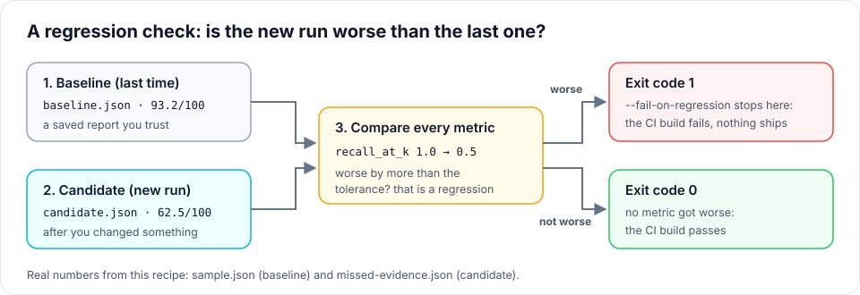

# 3. Catch regressions

**Goal:** compare a candidate run with a saved baseline and stop automation when
metrics get worse. **Before you start:** install the starter kit using
[recipe 1](first-evaluation.md). These commands run without a model.

A **regression** is a measured result becoming worse than the baseline beyond the
comparison tolerance. The comparator checks individual metrics, not only the
weighted overall score.

## A regression test in plain words

Think of two exam results. The **baseline** is the report of a run you trust. The
**candidate** is the report of a new run, after you changed a model, a prompt or a
chunk size. rag-titan compares the two **metric by metric**. If any metric got worse
by more than a small tolerance, that is a **regression**, and with
`--fail-on-regression` the command exits with code **1** instead of 0.



Why the exit code matters: CI systems such as GitHub Actions treat exit code 1 as a
failed step, so a worse RAG cannot be merged by accident.

## What you will see



The terminal replays the **real output** of this recipe's commands on the starter data.

## 1. Save the known baseline

```bash
rag-titan evaluate --input sample.json --output baseline.json --k 3
```

Keep this report. A baseline is a **report**, not the original `sample.json` data.
Use a separate output filename for each candidate so you do not overwrite it.

## 2. Prove that an unchanged run passes

```bash
rag-titan evaluate --input sample.json --output unchanged.json --baseline baseline.json --k 3 --fail-on-regression
```

The summary ends with:

```text
Regressions against the baseline: none
```

The process exits with code **0**, meaning this comparison passed.

## 3. Compare the broken candidate

<div class="cb-command" data-input="missed-evidence.json" data-output="candidate.json" data-compare="true">
<p>Enable JavaScript to customize the comparison, or use the command below.</p>
</div>

```bash
rag-titan evaluate --input missed-evidence.json --output candidate.json --baseline baseline.json --k 3 --fail-on-regression
```

The report lists regressions including `retrieval.recall_at_k`. The process exits
with code **1**. This failure is intentional: the candidate misses the leave-policy
evidence. Both `candidate.json` and `candidate.md` are saved before the process exits,
so you can inspect what happened.

Immediately after that command, inspect its exit code:

=== "macOS / Linux"

    ```bash
    echo $?
    ```

=== "Windows PowerShell"

    ```powershell
    $LASTEXITCODE
    ```

Expected: `1`. Check it immediately; a later command can replace the saved exit code.
Remove `--fail-on-regression` when you want a report without deliberately failing
the command. Without that flag, regressions are still listed.

## 4. Read exactly what changed

Save this as `compare_reports.py` in the starter folder:

```python
import json
from pathlib import Path

from rag_titan.evaluation import ReportManager

baseline = json.loads(Path("baseline.json").read_text(encoding="utf-8"))
candidate = json.loads(Path("candidate.json").read_text(encoding="utf-8"))

for change in ReportManager().regressions(candidate, baseline):
    print(f"{change['metric']}: {change['baseline']:.3f} -> {change['current']:.3f}")
```

Run it:

```bash
python compare_reports.py
```

You will see `retrieval.recall_at_k: 1.000 -> 0.500`, among other changes. A lower
latency is better; a lower recall is worse. The package uses each metric's scoring
policy to choose its direction.

## 5. Use the same command in automation

After your pipeline produces a new `candidate-data.json`, run:

```bash
rag-titan evaluate --input candidate-data.json --output candidate-report.json --baseline baseline.json --k 3 --fail-on-regression
```

A CI job that respects non-zero exit codes will fail when the comparison fails.
Retain the JSON and Markdown reports as artifacts, including on failure. Do not
append `|| true`, because that hides the failing exit code.

Before relying on this gate:

- Use the same questions, gold labels, K, scoring policy and package version.
- Check that the new data has all expected queries, stages and labels. Missing
  metrics are not automatically regressions: only comparable numeric measurements
  present in both reports are checked.
- Review noisy latency or cost changes across repeated live runs. The CLI uses the
  default tolerance: 0.02 absolute for quality metrics, 2% relative for cost and
  tokens. Timings jitter between runs, so a **latency** only counts as worse when
  it is more than **10% and more than 5 ms** slower (7.2 ms → 7.55 ms is noise).
- Inspect reranking *gain* metrics in context: improving retrieval can leave less
  improvement for the reranker and reduce its measured gain.
- Promote a new baseline only after reviewing its failures and coverage.

The Python API accepts a custom tolerance:

```python
changes = ReportManager().regressions(candidate, baseline, tolerance=0.05)
```

This is **0.05 absolute** for quality metrics and **5% relative** for telemetry;
it is not a universal “five percent score drop” rule. To count every slower
timing, also pass `latency_share=0, latency_min_ms=0`.

**Next:** [bring logs from another RAG](any-rag.md), or
[collect a live rag-titan run](live-pipeline.md).
