# Evaluating RAG

New to evaluation? Start with the [evaluation cookbook](cookbook/index.md): runnable
examples, animated stage walkthroughs and command builders for your terminal.

A RAG answer can only be as good as the chunks it is given. Before you change
the chunker, the retriever or the RAG type, **measure** how well it works on
your own questions, then compare. No method is best for every set of documents.



This page compares **setups** (chunkers and RAG types). To score each stage
of one pipeline (chunking, embedding, retrieval, reranking, context and
answers), or to evaluate a RAG system that is not built with rag-titan, see
[Evaluating every stage](stage-evaluation.md).

## The easy way

**1. Write a questions file.** For each question, name the file (or page) that
holds the answer ([format](#the-questions-file)):

```json
[{"id": "q_001", "question": "How many paid leave days do I get each year?",
  "required_evidence_ids": ["leave_policy.md"]}]
```

**2. Compare any ingestion with any RAG type**, end to end (uses the LLM):

```bash
rag-titan evaluate --files docs/*.md --questions questions.json \
    --rag-type simple adaptive --chunker word paragraph
```

```text
End-to-end report: 6 questions (evidence scored on the chunks given to the LLM)

setup                   Recall       MRR      nDCG  Answered     Steps     p50 s     p95 s
------------------------------------------------------------------------------------------
simple + word            1.000     1.000     1.000      100%       3.0      0.92      1.26
adaptive + word          1.000     1.000     1.000      100%       5.0      1.67      2.02
simple + paragraph       0.917     1.000     0.936      100%       3.0      0.64      0.81
adaptive + paragraph     1.000     1.000     0.987      100%       6.3      0.96      2.91

Questions to look at:
  simple + paragraph: q_006  recall 0.50  found ['remote_work.md']
```

Every `--rag-type` is tried with every `--chunker` (here 2 × 2 = 4 setups).
Setups with the same chunker share one index, so the files are embedded once
per chunker.

**3. See why one question went wrong**, step by step:

```bash
rag-titan ask --files docs/*.md --trace \
    --question "Can I work from Spain for a month?"
```

```text
1. retrieve     7.47 ms  query='Can I work from Spain for a month?', top_k=5
                         -> 3 chunks: chunk_2 remote_work.md (0.615), chunk_0 expenses.md (0.540), ...
2. rerank       0.04 ms  query='Can I work from Spain for a month?', matches=3 chunks, top_n=2
                         -> 2 chunks: chunk_2 remote_work.md (rerank 0.815), chunk_0 expenses.md (rerank 0.690)
3. generate   567.39 ms  query='Can I work from Spain for a month?', chunks=2 chunks
                         -> "I don't know based on the available documents."
```

Search **did** give the LLM `remote_work.md`, which allows 20 working days
abroad, and the LLM still said it does not know: the problem is the answer
step, not the search. Try a bigger model or another prompt, not another chunker.

The same in Python:

```python
from rag_titan import RAGTitan

rag = RAGTitan(rag_type="adaptive", settings={"chunker": "paragraph"})
rag.index(["leave_policy.md", "remote_work.md", "expenses.md"])

rag.evaluate("questions.json")                    # end to end, uses the LLM
rag.evaluate_retrieval("questions.json", top_k=3) # search only: fast, no LLM
print(rag.run("Can I work from Spain?")["log"])   # every step
```

All numbers on this page come from real runs with `gemma3:4b` and
`nomic-embed-text` on the three sample policies in `examples/sample_docs/`.
LLM replies change a little between runs, and 6 questions only show how the
tools work: for a real decision, write 30 to 100 questions (see [tips](#tips)).

## Comparing setups in Python

```python
from rag_titan.evaluation import compare_setups, format_rag_report

results = compare_setups(
    files=["leave_policy.md", "remote_work.md", "expenses.md"],
    questions="questions.json",
    setups=[
        {"name": "simple + word", "rag_type": "simple", "settings": {"chunker": "word"}},
        {"name": "adaptive + paragraph", "rag_type": "adaptive",
         "settings": {"chunker": "paragraph", "chunk_size": 300, "chunk_overlap": 0}},
    ],
)
print(format_rag_report(results))
```

`settings` can change any [setting](configuration.md): chunker, chunk size,
models, reranker. Each result has the averages and one row per question with
the answer, the files given to the LLM and every step of `run()`.

| Column | Meaning |
|---|---|
| Recall, MRR, nDCG | scored on the chunks **given to the LLM** (`sources` of `run()`), see [the metrics](#the-metrics) |
| Answered | share of questions not answered with "I don't know..." |
| Steps | average number of steps per question: loops and retries cost time |
| p50 s, p95 s | time per question, including the LLM |

When a RAG type gives up (Adaptive RAG after a failed evidence check) no chunks
reach the LLM, so that question scores 0 even if the search found the file.
To grade whether the answer itself is **correct** (answer F1, required facts,
citations), use [Evaluating every stage](stage-evaluation.md).

## Search only (no LLM)

Retrieval alone is much faster and does not depend on the LLM, so it is the
quickest way to compare chunkers and retrievers:

```python
from rag_titan.evaluation import compare_retrievers, format_report, load_questions

questions = load_questions("questions.json")
results = compare_retrievers({"dense": retriever}, questions, top_k=5)
print(format_report(results))
```

```text
Retrieval report: 6 questions, top_k=3

retriever        Recall@3       MRR    nDCG@3    p50 ms    p95 ms
-----------------------------------------------------------------
dense               1.000     1.000     0.987       7.0       8.5
dense_no_dedupe     1.000     1.000     0.987       7.1       8.4
```

This is the real output of `python examples/evaluate_retrieval.py`. It indexes
three short policies in `examples/sample_docs/` with Ollama embeddings and
compares the default retriever with one that keeps near-copies.

## The questions file

A JSON list. Each record says which evidence a good search must find:

```json
[
  {"id": "q_001",
   "question": "How many paid leave days do I get each year?",
   "required_evidence_ids": ["leave_policy.md"],
   "task_type": "fact"},
  {"id": "q_006",
   "question": "What do I get for working from home: equipment and money for furniture?",
   "required_evidence_ids": ["remote_work.md", "expenses.md"],
   "task_type": "multi_hop"}
]
```

| Key | Needed | Meaning |
|---|---|---|
| `id` | yes | a unique name, used in error messages and in the rows |
| `question` | yes | what to search for |
| `required_evidence_ids` | yes | one or more evidence ids (below); a multi-hop question lists several |
| `task_type` | no | your own label, like `fact`, `semantic`, `multi_hop` |
| anything else | no | kept as it is (for example `answer` or `tenant`) |

`load_questions()` checks every record and says which one is wrong:

```text
ValueError: Question 'q_007': Evidence id 'hr.pdf#4': write the page as '#p4'
```

### Evidence ids

| Evidence id | A chunk is evidence when |
|---|---|
| `"hr.pdf"` | it comes from `hr.pdf` |
| `"hr.pdf#p4"` | it comes from `hr.pdf` and its `page_numbers` include 4 |

Evidence ids name files and pages, **not chunk ids**. Chunk ids (`chunk_0`,
`chunk_1`, ...) change whenever you change the chunker, so labels written with
them would break. With files and pages you can compare chunkers on one file.

Each evidence counts **once**: when two overlapping chunks come from the same
page, only the first one counts, so near-copies never make a retriever look better.

## The metrics

Every metric is from 0 (bad) to 1 (perfect), computed for each question on the
first $k$ results, then averaged.

| Metric | Formula | Answers the question |
|---|---|---|
| **Recall@k** | $\dfrac{\lvert \text{Relevant} \cap \text{Retrieved}_k \rvert}{\lvert \text{Relevant} \rvert}$ | did we find **all** the evidence? |
| **MRR** | $\dfrac{1}{N} \sum_q \dfrac{1}{\text{rank}_q}$ | how high is the **first** piece of evidence? |
| **nDCG@k** | $\dfrac{\sum_r g_r / \log_2(r+1)}{\text{IDCG}}$ | is the evidence **near the top**? |
| **p50 / p95 ms** | median and 95th percentile time per search | how fast, including the slow searches |

For nDCG, $g_r$ is the number of new evidences found at rank $r$, and IDCG is
the best possible score: one new evidence at each of the first
$\min(\lvert \text{Relevant} \rvert, k)$ ranks. One chunk can hold two
evidences (pages 4 and 5), so the score is capped at 1.

**Worked example.** A question needs `a.pdf#p4` and `c.txt`. The search returns:

| Rank | Chunk from | New evidence |
|---|---|---|
| 1 | `a.pdf` page 1 | – |
| 2 | `b.pdf` page 2 | – |
| 3 | `a.pdf` page 4 | `a.pdf#p4` |
| 4 | `a.pdf` page 4 again | – (already found) |
| 5 | `c.txt` | `c.txt` |

- Recall@5 $= 2/2 = 1.0$, but Recall@3 $= 1/2 = 0.5$
- reciprocal rank $= 1/3$ (first evidence at rank 3)
- nDCG@5 $= \dfrac{1/\log_2 4 + 1/\log_2 6}{1 + 1/\log_2 3} = \dfrac{0.887}{1.631} \approx 0.544$

Latency is reported as p50 and p95, not only an average: the average hides the
few slow searches that users notice.

## Retrieval results in Python

`evaluate_retriever()` returns the averages and one row per question, so you
can find the questions that fail:

```python
from rag_titan.evaluation import evaluate_retriever

result = evaluate_retriever(retriever, questions, top_k=5)
result["recall"], result["mrr"], result["ndcg"], result["p95_ms"]

for row in result["rows"]:
    if row["recall"] < 1:
        print(row["id"], row["task_type"], row["sources"])
```

`compare_retrievers({"name": retriever, ...}, questions, top_k)` runs every
retriever on **the same questions with the same top_k**, and returns one such
result per retriever.

## Tips

- Write **30 to 100 questions** for each kind of question that matters to you.
  A handful of questions is a smoke test, not proof that one method is better.
- Include questions that need **several** pieces of evidence: a single label per
  question hides weak multi-hop retrieval.
- Use page labels (`#p4`) for long PDFs: a file label is too easy to match.
- Compare under identical conditions: same files, chunker, embedder and `top_k`.

To grade the answers themselves (correctness, citations, grounding) and get a
0 to 100 scorecard, continue with [Evaluating every stage](stage-evaluation.md).
