# Getting started

## 1. Install the package

```bash
pip install rag-titan
```

Python 3.10 or newer is required.

!!! tip "Windows: rag-titan.exe is blocked?"
    Smart App Control or a company application-control policy can block the
    `rag-titan.exe` launcher that pip creates ("An Application Control policy has
    blocked this file"). rag-titan is fine; only the launcher is blocked. Run the
    same command through Python instead, everywhere in these docs:

    ```powershell
    python -m pip install rag-titan
    python -m rag_titan --version
    python -m rag_titan evaluate --input data.json --output report.json --k 3
    ```

    Use `python -m pip`, not `pip`, so the package goes into the same Python you run.
    Please do not turn off Smart App Control for this: Windows cannot turn it back
    on without a reset.

    Seeing `DLL load failed while importing _pydantic_core` when you create
    `RAGTitan(...)`? Versions before 0.8.4 needed pydantic, whose compiled file
    these policies block. Since 0.8.4 rag-titan talks to Ollama with plain Python,
    so upgrading fixes it: `python -m pip install --upgrade rag-titan`.

## 2. Install Ollama and pull the models

`rag-titan` uses [Ollama](https://ollama.com) to run models on your own computer.

```bash
ollama pull gemma3:4b          # chat model, writes the answers
ollama pull nomic-embed-text   # embedding model, turns text into vectors
```

Make sure Ollama is running (`ollama serve`, or open the Ollama app).

## 3. Ask your first question

```python
from rag_titan import RAGTitan, setup_logging

setup_logging("INFO")              # optional: show what is happening

rag = RAGTitan(rag_type="simple")
chunk_count = rag.index(["handbook.pdf", "policy.docx"])
print(f"Indexed {chunk_count} chunks")

print(rag.ask("How many leave days do I get?"))
```

What happens:

1. `index()` reads each file, splits it into chunks, turns every chunk into a
   vector and saves it in memory.
2. `ask()` turns the question into a vector, finds the most similar chunks,
   reranks them and asks the LLM to answer using only those chunks.

The answer cites the chunks it used, for example `[chunk_0]`.



## 4. Try another RAG type

```python
rag = RAGTitan(rag_type="adaptive")
```

See [RAG types](rag-types.md) for the differences.

!!! note "Data lives in memory"
    The default vector store keeps everything in memory, so you must call
    `index()` again each time your program starts.
