[Already have a RAG? Evaluate it →](cookbook/index.md#choose-your-path){ .md-button .md-button--primary }
[New here? Get started →](getting-started.md){ .md-button }

RAG lets a language model answer questions about *your* documents. It first
**finds** the most relevant pieces of text, then asks the model to **answer
using only those pieces**.

With `rag-titan` you get:

- **Many RAG types, one API.** Switch with one word (`rag_type="adaptive"`), and
  see every step a type took with `run()`. → [RAG types](rag-types.md)
- **Answers grounded in your files.** The model answers only from your documents
  and cites the chunks and pages it used, running locally with Ollama.
- **Chunking your way.** Eight chunkers, from fixed word windows to whole
  sentences, paragraphs, heading sections or pages. → [Chunking methods](chunking.md)
- **Measure, don't guess.** Compare any chunker with any RAG type on your own
  questions in one command. → [Evaluating RAG](evaluation.md)
- **Find the stage that fails.** Score chunking, embedding, retrieval, reranking,
  context and answers of **any** RAG system from its logged outputs, with a 0 to 100
  scorecard and regression checks. → [Evaluating every stage](stage-evaluation.md)
- **Already have a RAG?** Evaluate it in 6 simple steps, no model needed.
  → [Evaluation cookbook](cookbook/index.md#choose-your-path)
- **Watch it work in your browser.** The [RAG playground](rag-playground.md) lights
  up every step on a live flow diagram; the [chunk playground](playground.md)
  shows how text is cut.
- **Easy to change.** Swap the LLM, embedder, vector store, chunker or RAG type by
  inheriting one base class. → [Extending rag-titan](extending.md)

```python
from rag_titan import RAGTitan

rag = RAGTitan(rag_type="simple")
rag.index(["handbook.pdf"])
print(rag.ask("How many leave days do I get?"))
```



## Where to go next

| I want to...                         | Read                                   |
|--------------------------------------|----------------------------------------|
| install it and ask my first question | [Getting started](getting-started.md)  |
| learn evaluation with copy-and-run recipes | [Evaluation cookbook](cookbook/index.md) |
| run RAG types in my browser          | [RAG playground](rag-playground.md)    |
| choose a RAG type                    | [RAG types](rag-types.md)              |
| compare setups on my own questions   | [Evaluating RAG](evaluation.md)        |
| score every stage of a RAG pipeline  | [Evaluating every stage](stage-evaluation.md) |
| look up a metric and its formula     | [Evaluation metrics](evaluation-metrics.md) |
| understand each part                 | [Building blocks](building-blocks.md)  |
| change models or chunk sizes         | [Configuration](configuration.md)      |
| add my own vector store or LLM       | [Extending rag-titan](extending.md)    |
