# RAG types

## Supported RAG types

rag-titan supports **2 RAG types**. Every one has the same methods,
`answer(question)` and [`run(question)`](#seeing-every-step-run), and with
`RAGTitan` you pick one using `rag_type`.

| Status | RAG type | How it works | Best for | LLM calls |
|---|---|---|---|---|
| ✅ Available | [**Simple RAG**](#simple-rag-simple)<br>`rag_type="simple"` | Retrieve → Rerank → Generate | Fast answers to clear questions | 1 |
| ✅ Available | [**Adaptive RAG**](#adaptive-rag-adaptive)<br>`rag_type="adaptive"` | Route → Retrieve → Check evidence → Rewrite & retry | Mixed questions, fewer wrong answers | 2–5 |

```python
from rag_titan import RAG_TYPES, RAGTitan

print(RAG_TYPES)                      # ['simple', 'adaptive']
rag = RAGTitan(rag_type="adaptive")   # any value from RAG_TYPES
```

Asking for a type that does not exist yet raises a clear error:

```text
ValueError: Unknown RAG type: graph. Choose from ['simple', 'adaptive']
```

See [Planned RAG types](#planned-rag-types) for what is coming next.

## Simple RAG (`"simple"`)

```
Question -> Retrieve -> Rerank -> Generate
```

The classic RAG. It searches once and answers once.



- **Good for:** clear factual questions, fast answers, learning how RAG works.
- **LLM calls per question:** 1
- **Options:** `top_k` (chunks to retrieve, default 5), `top_n` (chunks to keep, default 2)

```python
from rag_titan import SimpleRAG

rag = SimpleRAG(retriever, reranker, generator, top_k=5, top_n=2)
```

## Adaptive RAG (`"adaptive"`)

```
Question -> Choose route -> Retrieve -> Rerank -> Check evidence
                                                 |
                                 Enough evidence -> Answer
                                                 |
                             Not enough -> Rewrite and retry
```

It decides how much work each question needs:



| Route     | When                           | What it does                     |
|-----------|--------------------------------|----------------------------------|
| `direct`  | greetings, thanks, goodbyes    | replies without searching        |
| `simple`  | one-topic factual question     | small search (top_k 4, top_n 2)  |
| `complex` | comparisons, multi-part        | bigger search (top_k 8, top_n 4) |

After searching, the LLM checks if the chunks really answer the question. If
not, the question is rewritten into a better search query and the search is
made wider. After `max_attempts` (default 2) it says it does not know.

- **Good for:** mixed questions, avoiding wrong answers.
- **LLM calls per question:** 2 (greeting) to 5 (one retry), with the default `max_attempts=2`
- **Parts:** `Router`, `EvidenceChecker`, `QueryRewriter`

## Comparing RAG types

```python
from rag_titan import RAG_TYPES, build_rag, build_rag_parts, get_settings

parts = build_rag_parts(get_settings())
parts["pipeline"].run(["handbook.pdf"])        # index once

for rag_type in RAG_TYPES:
    print(rag_type, build_rag(rag_type, parts).answer("How many leave days?"))
```

## Seeing every step: `run()`

`answer()` returns only the text. `run()` also returns the chunks used and
every step the RAG type took, with its input, output and time:

```python
from rag_titan.rag_types import describe_steps

result = rag.run("how many leave days?")
result["answer"]     # same text as rag.answer(...)
result["sources"]    # the chunks given to the generator
result["steps"]      # [{"step": "route", "input": {...}, "output": "simple", "ms": 412.0}, ...]

print(describe_steps(result["steps"]))
```

With `RAGTitan`, `rag.run(question)` gives the same dict plus `"log"`, the
readable text below: `print(rag.run("how many leave days?")["log"])`.

Adaptive RAG that did not find enough evidence the first time, then rewrote the
query and searched wider (timings from a test with a fake LLM):

```text
1. route        0.00 ms  query='how many leave days?'
                         -> 'simple'
2. retrieve     0.06 ms  query='how many leave days?', top_k=4
                         -> 3 chunks: chunk_0 hr.pdf (0.707), chunk_1 hr.pdf (0.000), chunk_2 it.pdf (0.000)
3. rerank       0.01 ms  query='how many leave days?', matches=3 chunks, top_n=2
                         -> 2 chunks: chunk_0 hr.pdf (rerank 0.807), chunk_1 hr.pdf (rerank 0.000)
4. check        0.01 ms  query='how many leave days?', chunks=2 chunks
                         -> False
5. rewrite      0.00 ms  query='how many leave days?'
                         -> 'annual leave days per year'
6. retrieve     0.01 ms  query='annual leave days per year', top_k=8
                         -> 3 chunks: chunk_0 hr.pdf (1.000), chunk_1 hr.pdf (0.000), chunk_2 it.pdf (0.000)
7. rerank       0.01 ms  query='how many leave days?', matches=3 chunks, top_n=4
                         -> 3 chunks: chunk_0 hr.pdf (rerank 1.100), chunk_1 hr.pdf (rerank 0.000), chunk_2 it.pdf (rerank 0.000)
8. check        0.00 ms  query='how many leave days?', chunks=3 chunks
                         -> True
9. generate     0.00 ms  query='how many leave days?', chunks=3 chunks
                         -> 'You get 20 leave days [chunk_0]'
```

### The flow of each RAG type

Every RAG type also describes its steps and the arrows between them in `FLOW`.
The steps that `run()` records always follow these arrows (a test checks it),
so a diagram can be drawn from `FLOW` and lit up with a real run.

```python
from rag_titan import AdaptiveRAG

AdaptiveRAG.FLOW["nodes"][0]   # {"id": "route", "label": "Choose route", "kind": "llm"}
AdaptiveRAG.FLOW["edges"][:2]  # [["route", "direct_reply"], ["route", "retrieve"]]
```

`kind` is `search`, `llm` or `output`. The [RAG playground](rag-playground.md)
draws every RAG type from its `FLOW` and lights it up with a real run, in your
browser.

## Planned RAG types

These are **not available yet**. They will be added as new `rag_type` values,
so code that uses `RAGTitan` keeps working.

| Status | RAG type | Idea |
|---|---|---|
| 🔜 Planned | Corrective RAG (CRAG) | Grade each chunk and fall back to web search when they are weak |
| 🔜 Planned | Multi-query RAG | Ask several versions of the question and merge the results |
| 🔜 Planned | HyDE | Write a hypothetical answer first, then search with it |
| 🔜 Planned | Hybrid RAG | Combine keyword (BM25) and vector search |
| 🔜 Planned | Self-RAG | The model checks and improves its own answer |
| 🔜 Planned | Parent-document RAG | Search small chunks, answer with the bigger section around them |
| 🔜 Planned | Graph RAG | Search a knowledge graph built from your documents |
| 🔜 Planned | Agentic RAG | An agent decides when and what to search |

Want one sooner? Open an issue or read [Extending rag-titan](extending.md#adding-a-new-rag-type).
See the full [roadmap](roadmap.md).
