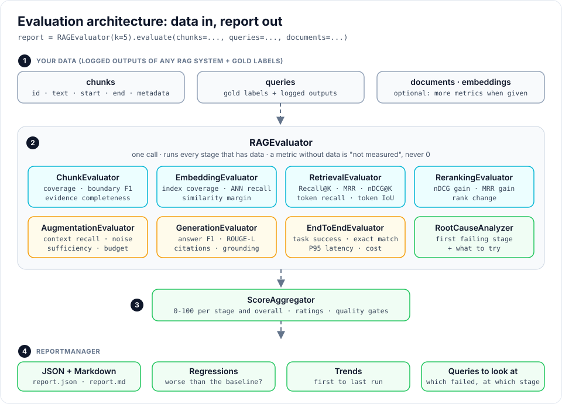

# Evaluating every stage

For a guided first run, use the [evaluation cookbook](cookbook/index.md). It includes
a downloadable starter kit, interactive failure examples and copyable CLI commands.

When a RAG answer is wrong, **which part failed?** The chunker cut the fact in
two, the search missed it, the reranker pushed it down, it did not fit in the
prompt, or the LLM ignored it. Stage evaluation scores each part on its own, so
you fix the right one.

It works for **any RAG system**, not only rag-titan: you pass what your system
produced plus the right answers, and get a report. No LLM judge, no extra
dependencies.



!!! note "Two kinds of evaluation"
    [Evaluating RAG](evaluation.md) **runs** rag-titan setups and compares
    chunkers and RAG types. This page **scores logged outputs** stage by
    stage. Use both: compare setups first, then look inside the best one.

## Quick start

=== "Your own RAG system"

    Log what each stage produced, add the gold labels, and evaluate:

    ```python
    from rag_titan.evaluation import RAGEvaluator

    chunks = [
        {"id": "c1", "text": "Employees get 25 days of annual leave. "},
        {"id": "c2", "text": "Sick pay is full salary for 10 days. "},
        {"id": "c3", "text": "Remote work is allowed 3 days a week."},
    ]
    queries = [{
        "id": "q1",
        "expected_chunk_ids": ["c1"],            # gold: the chunk with the answer
        "expected_answer": "Employees get 25 days of annual leave.",
        "retrieved_ids": ["c2", "c1", "c3"],     # your retriever, best first
        "reranked_ids": ["c1", "c2", "c3"],      # your reranker
        "context_ids": ["c1", "c2"],             # what went into the prompt
        "answer": "Employees get 25 days of annual leave.",
        "latency_ms": 840,
    }]

    report = RAGEvaluator(k=3).evaluate(chunks=chunks, queries=queries)

    print(report["retrieval"]["summary"]["mrr_at_k"])    # 0.5: gold at rank 2
    print(report["reranking"]["summary"]["mrr_gain"])    # 0.5: moved to rank 1
    print(report["generation"]["summary"]["answer_f1"])  # 1.0
    print(report["scorecard"]["overall"]["score"])       # 0 to 100
    ```

=== "A data file"

    Put the same data in a JSON file and use the command line:

    ```bash
    rag-titan evaluate --input data.json --output report.json --k 3
    ```

    ```text
    Reports saved: report.json and report.md
    Overall score: 93.2/100 (Excellent)
    Status: Evaluated | Measurement coverage: 97%
    First failing stage: none
    ```

    Try it with the sample: `examples/rag_evaluation_sample.json`.
    Have logs from your own RAG? `build_dataset()` turns them and your golden
    questions into this file, see [Evaluate your own RAG](cookbook/any-rag.md).

=== "A rag-titan pipeline"

    rag-titan can collect the data itself. Write golden questions with the
    exact quote that holds the answer, and call `evaluate_stages()`:

    ```json
    [{"id": "g_001", "question": "How many paid leave days do I get each year?",
      "expected_evidence": ["gets 20 paid leave days per calendar year"],
      "expected_answer": "Every full-time employee gets 20 paid leave days per calendar year.",
      "required_facts": ["20"], "validated": true}]
    ```

    ```python
    from rag_titan import RAGTitan

    rag = RAGTitan(rag_type="simple")
    report = rag.evaluate_stages(["leave_policy.md", "remote_work.md", "expenses.md"],
                                 "golden.json", include_embeddings=True)
    ```

    ```text
    Overall score: 80.5/100 (Very Good)
    Status: Evaluated | Measurement coverage: 76%
    First failing stage: none
    ```

    A real run with `gemma3:4b` on `examples/sample_docs/`:
    `python examples/evaluate_stages.py --live`.

Start small. A stage is evaluated **only when its data is there**, and a
metric without data is "not measured", never 0. Retrieved ids and gold ids
are enough for the first report; add stages as you log more.

## One stage at a time

Every evaluator also works alone:

```python
from rag_titan.evaluation import ChunkEvaluator, RetrievalEvaluator

text = "Leave is 25 days. Sick pay is full. Travel needs approval."
chunks = ["Leave is 25 days. ", "Sick pay is full. ", "Travel needs approval."]

scores = ChunkEvaluator().evaluate(
    chunks, document_text=text,
    expected_evidence=["25 days", "Sick pay is full"],    # must stay whole
    size_limits=(3, 50),
)
print(scores["coverage"], scores["evidence_completeness"])    # 1.0 1.0

query = {"id": "q1", "expected_evidence": ["25 days"],
         "expected_chunk_ids": ["chunk_1"],                   # ids: chunk_1, chunk_2, ...
         "retrieved_ids": ["chunk_3", "chunk_1"]}
result = RetrievalEvaluator().evaluate(chunks, [query], k=2, document_text=text)

summary = result["summary"]
print(summary["recall_at_k"], summary["token_precision"])     # 1.0 0.2857...
```

| Evaluator | Scores | Minimum input |
|---|---|---|
| `ChunkEvaluator` | the chunks | `chunks` |
| `EmbeddingEvaluator` | vectors and the vector index | `vectors` |
| `RetrievalEvaluator` | ranked search results | `queries` with `retrieved_ids` and gold labels |
| `RerankingEvaluator` | the order after reranking | `queries` with `reranked_ids` |
| `AugmentationEvaluator` | the context in the prompt | `queries` with `context_ids` |
| `GenerationEvaluator` | the answers | `queries` with `answer` |
| `EndToEndEvaluator` | correctness, success, latency, cost | `queries` with `answer` |

All formulas are on the [Evaluation metrics](evaluation-metrics.md) page.

## The data

`RAGEvaluator.evaluate()` takes these inputs. Only what you pass is scored.

| Input | Type | Purpose |
|---|---|---|
| `chunks` | list of texts or dicts | the chunks of your index |
| `queries` | list of dicts | gold labels and logged outputs per question |
| `document_text` | text | the source text of one document |
| `documents` | `{doc_id: text}` | the source texts of several documents |
| `embeddings` | dict | vectors and vector-index results |
| `max_context_tokens` | number | the context budget, in words |
| `expected_chunks` | list | ideal chunks marked by a person, for Boundary F1 |
| `expected_evidence` | list | quotes or spans that must stay in one chunk |
| `structural_blocks` | list | tables, lists or code that must stay whole |
| `required_metadata` | list of keys | metadata every chunk must have |
| `expected_metadata` | `{chunk_id: {key: value}}` | correct metadata values |
| `size_limits` | `(min, max)` | valid chunk size, in words |
| `boundary_tolerance` | number | characters two boundaries may differ |
| `sentence_vectors` | `{chunk_id: [vector, ...]}` | one vector per sentence, for semantic cohesion |
| `chunk_vectors` | `{chunk_id: vector}` | default: the vectors in `embeddings` |

### A chunk

A text, or a dict:

| Key | Meaning |
|---|---|
| `id` | unique id; default `chunk_1`, `chunk_2`, ... |
| `text` | the chunk text |
| `start`, `end` | character offsets in the document; found by searching for `text` when missing |
| `doc_id` | which document, needed when you pass `documents` with several texts |
| `metadata` | any dict, e.g. `{"source": "hr.pdf", "page": 4}` |

Give `start` and `end` when you have them: a chunk whose text occurs twice, or
was cleaned up by the chunker, cannot be placed by searching. The report then
has a warning and leaves the span metrics unmeasured.

### A query

| Key | Read by | Meaning |
|---|---|---|
| `id` | all | unique id (required) |
| `expected_chunk_ids` | retrieval, reranking | gold chunk ids |
| `relevance` | retrieval, reranking | graded gold labels `{chunk_id: grade}`, e.g. 3 = perfect, 1 = related |
| `expected_evidence` | retrieval, augmentation | exact quotes, or `{"start", "end", "doc_id"}` spans |
| `retrieved_ids` | retrieval, reranking | what the retriever returned, best first |
| `reranked_ids` | reranking | what the reranker returned |
| `context_ids` | augmentation, generation | the chunks that went into the prompt, in order |
| `context` | generation | the prompt context as text, instead of `context_ids` |
| `answer` | generation, end to end | the generated answer |
| `expected_answer` | generation, end to end | the validated reference answer |
| `required_facts` | generation | phrases the answer must contain |
| `citations`, `expected_citations` | generation | cited and expected source ids |
| `verified_claims` | generation | your labels: `[{"text": ..., "supported": true}]` |
| `answerable`, `abstained` | generation | can it be answered, and did the system refuse? |
| `task_success` | generation, end to end | your verdict: `true` or `false` |
| `retrieval_latency_ms`, `generation_latency_ms`, `latency_ms` | retrieval, generation, end to end | time of each part and of the whole request |
| `cost_usd`, `total_tokens` | end to end | request telemetry |

A quote in `expected_evidence` must occur **exactly once** in the documents;
otherwise give a span. Quotes are the best gold labels: they do not change
when you change the chunker.

### Embeddings

| Key | Meaning |
|---|---|
| `vectors` | `{chunk_id: vector}` (required) |
| `query_vectors` | `{query_id: vector}` |
| `relevant_ids` | `{query_id: [gold chunk ids]}` |
| `indexed_ids` | the chunk ids really stored in your vector index |
| `index_results` | `{query_id: [chunk ids the index returned]}`, to measure ANN recall |

## The report

```python
report = RAGEvaluator(k=5).evaluate(**dataset)
```

| Entry | Holds |
|---|---|
| `chunking`, `embedding`, `end_to_end` | the metrics of the stage |
| `retrieval`, `reranking`, `augmentation`, `generation` | `summary` (means) and `per_query` (one dict per query) |
| `root_causes` | the thresholds that failed, in pipeline order |
| `scorecard` | 0 to 100 scores, ratings and status |

### Root-cause hints

A failure early in the pipeline explains failures later, so the checks run in
pipeline order and name the **first failing stage**:

```python
causes = report["root_causes"]
print(causes["first_failing_stage"])            # "retrieval"
for item in causes["failures"]:
    print(item["stage"], item["metric"], item["observed"], "<", item["minimum"])
    print("  ", item["suggestion"])
```

| Stage | Metric | Minimum |
|---|---|---|
| chunking | `coverage` | 0.98 |
| chunking | `evidence_completeness` | 0.90 |
| embedding | `index_coverage` | 0.98 |
| embedding | `query_topk_recall` | 0.80 |
| retrieval | `recall_at_k` | 0.80 |
| reranking | `ndcg_gain` | -0.03 |
| augmentation | `context_sufficient` | 0.90 |
| generation | `answer_f1` | 0.75 |

Change them with `RAGEvaluator(thresholds={"recall_at_k": 0.9})`. These are
rules that tell you where to look first, not a proof of the cause.

## The scorecard

`report["scorecard"]` turns the metrics into numbers you can show anyone:

```text
Overall: 93.2/100 - Excellent
Assessment: Evaluated · Measurement coverage: 97%

| Pipeline stage       | Score / 100 | Rating    | Measurement coverage |
|----------------------|------------:|-----------|---------------------:|
| Document preparation |        97.6 | Excellent |                  74% |
| Semantic indexing    |        98.4 | Excellent |                 100% |
| Information search   |        79.4 | Good      |                 100% |
| Search ordering      |        89.7 | Very Good |                 100% |
| Answer context       |        92.3 | Excellent |                 100% |
| Answer quality       |       100.0 | Excellent |                 100% |
| User experience      |       100.0 | Excellent |                 100% |
```

### How a score is made

1. Every measured metric becomes a 0 to 1 score (table below).
2. A stage score is the weighted mean of its measured metrics:

    $$
    \text{Stage score} = \frac{\sum_m w_m \, s_m}{\sum_m w_m}
    \qquad
    \text{Coverage} = \frac{\sum_{m \text{ measured}} w_m}{\sum_{m \text{ all}} w_m}
    $$

3. The overall score weights each stage by its weight times its coverage, so
   a stage you barely measured counts for less:

    $$
    \text{Overall} = \frac{\sum_s W_s \, c_s \, \text{score}_s}{\sum_s W_s \, c_s}
    $$

| Kind of metric | Score | Example |
|---|---|---|
| higher is better (rates) | $s = v$ | recall 0.8 → 80% |
| lower is better (rates) | $s = 1 - v$ | noise 0.1 → 90% |
| penalty ratio | $s = 1 / (1 + v)$ | redundancy 0.25 → 80% |
| fragmentation | $s = 1 / \max(1, v)$ | 2 chunks per span → 50% |
| cosine, higher is better | $s = (1 + \cos) / 2$ | cosine 0.6 → 80% |
| cosine, lower is better | $s = (1 - \cos) / 2$ | cosine 0 → 50% |
| cosine distance | $s = v / 2$ | $1 - \cos = 1$ → 50% |
| similarity margin | $s = \text{clamp}(0.5 + v, 0, 1)$ | margin 0.25 → 75% |
| gain (after − before) | $s = (1 + v) / 2$ | no change → 50% |
| target (latency, cost, sizes) | $s = \min(1, \text{target} / v)$ | 2000 ms for a 1000 ms target → 50% |

Stage weights: chunking 10, embedding 10, retrieval 20, reranking 10,
augmentation 15, generation 20, end to end 15. The metric weights are in
`rag_titan/evaluation/scoring/policy.py`. They are sensible defaults, **not an
industry standard**: change them to match what matters to you.

### Ratings and status

| Score | Rating |
|---|---|
| 90 to 100 | Excellent |
| 80 to 90 | Very Good |
| 70 to 80 | Good |
| 60 to 70 | Average |
| 40 to 60 | Needs Improvement |
| 0 to 40 | Poor |

| Status | Meaning |
|---|---|
| Evaluated | enough was measured and no quality gate failed |
| Provisional | less than 75% of the scoring policy was measured |
| Action Required | a quality gate failed, however high the score |
| Not Evaluated | nothing could be scored |

**Quality gates** are minimums for the metrics that matter most: chunking
`coverage` 0.95 and `evidence_completeness` 0.80, embedding `index_coverage`
0.95, retrieval `recall_at_k` 0.70, augmentation `context_sufficient` 0.80,
generation `annotated_claim_support` 0.80, end-to-end `task_success_rate` 0.75.

### Your own weights, targets and stages

```python
from rag_titan.evaluation import RAGEvaluator, ScoreAggregator

scorer = ScoreAggregator(
    stages=["retrieval", "generation", "end_to_end"],        # score only these
    stage_weights={"retrieval": 40},                          # search matters most here
    metric_weights={"generation": {"exact_match": 0}},        # 0 switches a metric off
    targets={"end_to_end": {"p95_latency_ms": 2000},          # scored only with a target
             "retrieval": {"p95_latency_ms": 200}},
    quality_gates={"retrieval": {"recall_at_k": 0.85}},
)
report = RAGEvaluator(k=5, scorer=scorer).evaluate(**dataset)
```

Latency, cost and chunk sizes have no universal "good" value, so they are
scored **only when you set a target**. A size target can be a band:
`{"chunking": {"mean_chunk_tokens": {"min": 150, "max": 400}}}`.

If you evaluate only some stages, pass `stages=[...]`. Otherwise the default
scorecard counts the missing stages as not measured and the status is
"Provisional".

## Reports and regressions

```python
from rag_titan.evaluation import ReportManager

manager = ReportManager()
manager.save_json(report, "reports/2026-11-12.json")
manager.save_markdown(report, "reports/2026-11-12.md")

baseline = manager.load_json("reports/2026-11-05.json")
for item in manager.regressions(report, baseline):          # what got worse
    print(item["metric"], item["baseline"], "->", item["current"])

for item in manager.failed_queries(report):                 # which queries failed, and where
    print(item["query_id"], item["stage"], item["reason"])

changes = manager.trends([week1, week2, week3])             # first-to-last change per metric
print(changes["retrieval.recall_at_k"])
```

The Markdown report has the scorecard, the improvement priorities, one table
per stage, the queries to look at and the root-cause hints.

A metric is a **regression** when it got worse than the baseline by more than
`tolerance` (default 0.02): 2 points for scores, 2% for latency, cost and
tokens. "Worse" follows the scoring policy: recall going down, noise or
latency going up.

!!! note "Reranking gains can shrink for a good reason"
    `ndcg_gain` and `mrr_gain` measure what the reranker **adds**. When the
    retriever improves, there is less left to fix, so the gains drop. Check
    `reranking.ndcg_at_k` before calling that a regression.

### Continuous evaluation

Run the evaluation on a schedule and fail the job when quality drops:

```bash
rag-titan evaluate --input data.json --output reports/today.json \
    --baseline reports/baseline.json --fail-on-regression
```

The reports are saved first, then the command exits with code 1 if a metric
got worse. A daily GitHub Actions job:

```yaml
name: rag-evaluation
on:
  schedule:
    - cron: "0 6 * * *"        # every day at 06:00 UTC
  workflow_dispatch:

jobs:
  evaluate:
    runs-on: ubuntu-latest
    steps:
      - uses: actions/checkout@v4
      - uses: actions/setup-python@v5
        with:
          python-version: "3.12"
      - run: pip install rag-titan
      - run: python collect_logs.py > data.json      # your script: export yesterday's runs
      - run: >
          rag-titan evaluate --input data.json --output reports/today.json
          --baseline reports/baseline.json --fail-on-regression
      - uses: actions/upload-artifact@v4
        if: always()
        with:
          name: rag-report
          path: reports/
```

## Preparing the data

Scores are only as good as the test set. Three helpers cover the steps
before the evaluation.

**1. Profile the documents**: find the empty, tiny and duplicated ones.

```python
from rag_titan.evaluation import profile_documents

documents = {"leave.md": "...", "remote.md": "...", "old_leave.md": "..."}
profile = profile_documents(documents, min_words=20)

profile["document_count"], profile["mean_words"], profile["categories"]
profile["exact_duplicates"]      # [["leave.md", "old_leave.md"]]
profile["issues"]                # {"old_leave.md": ["exact duplicate"]}
profile["clean_share"]           # documents without any issue / all documents
```

Documents can also be a list of dicts with `id` (or `source`), `text` and an
optional `category`, which is what rag-titan's loaders return.

**2. Sample** the documents you will write questions for.

```python
from rag_titan.evaluation import sample_documents

ids = sample_documents(documents, size=20, strategy="risk", seed=7, profile=profile)
```

| Strategy | Picks |
|---|---|
| `"random"` | every document with the same chance |
| `"stratified"` | every `category` in proportion to its size |
| `"risk"` | documents with profiling issues first, then random |

The same `seed` always gives the same sample.

**3. Write and validate the golden set.** For each question write the quote
that holds the answer and the expected answer. A person then checks every
question and sets `"validated": true`.

```python
from rag_titan.evaluation import check_golden

result = check_golden("golden.json", documents)
print(result["validated_share"], result["ready"])
for item in result["problems"]:
    print(item["id"], item["problem"])
```

```text
g_007 quote 'up to 5 days' is not found exactly once
g_012 required fact 'HR' is not in the expected_answer
```

`ready` is `True` when there are no problems and every question is validated.

!!! tip "Documents in S3 or another store"
    The evaluation needs only texts. Download the files with your own client
    and pass them as a dict:

    ```python
    import boto3

    s3 = boto3.client("s3")
    keys = [item["Key"] for item in s3.list_objects_v2(Bucket="my-docs")["Contents"]]
    documents = {key: s3.get_object(Bucket="my-docs", Key=key)["Body"].read().decode("utf-8")
                 for key in keys}
    ```

## The whole workflow

| Step | What | With |
|---|---|---|
| 1 | Collect the documents | your storage client (S3, disk, ...) or rag-titan's loaders |
| 2 | Profile: quality, completeness, duplicates, categories | `profile_documents()` |
| 3 | Sample: random, stratified, risk-based | `sample_documents()` |
| 4 | Write the golden set: questions, answers, evidence | a JSON file, see [above](#quick-start) |
| 5 | Validate the ground truth by a person | `"validated": true`, `check_golden()` |
| 6 | Chunking | `ChunkEvaluator` |
| 7 | Embedding and index | `EmbeddingEvaluator` |
| 8 | Retrieval | `RetrievalEvaluator` |
| 9 | Reranking | `RerankingEvaluator` |
| 10 | Augmentation (context) | `AugmentationEvaluator` |
| 11 | Generation | `GenerationEvaluator` |
| 12 | End to end | `EndToEndEvaluator` |
| 13 | Root cause | `RootCauseAnalyzer` |
| 14 | Reports: scores, failures, trends | `ScoreAggregator`, `ReportManager` |
| 15 | Continuous evaluation and regression tests | `rag-titan evaluate --baseline ... --fail-on-regression` on a schedule |

Steps 6 to 14 are one call: `RAGEvaluator().evaluate(...)`.

## With a rag-titan pipeline

`collect_dataset()` runs the pipeline on the golden questions and builds the
data: the real chunks with their offsets, the retrieved and reranked ids, the
context, the answer with its citations taken out, and the time of each step.

```python
from rag_titan import RAGTitan
from rag_titan.evaluation import RAGEvaluator, ReportManager, collect_dataset

rag = RAGTitan(rag_type="adaptive", settings={"chunker": "paragraph"})
dataset = collect_dataset(rag, files, "golden.json", include_embeddings=True)

report = RAGEvaluator(k=5).evaluate(**dataset, size_limits=(20, 300))
ReportManager().save_markdown(report, "report.md")
```

`rag.evaluate_stages(files, "golden.json")` does the same in one call.

The gold chunks of a question come from the first of these it has:

| Gold label | Gold chunks |
|---|---|
| `expected_chunk_ids` or `relevance` | the chunk ids you wrote |
| `expected_evidence` (quotes) | the chunks that hold the quotes |
| `required_evidence_ids` (`"hr.pdf"`, `"hr.pdf#p4"`) | **every** chunk of the file or page |

So the [questions file](evaluation.md#the-questions-file) you already have
works too. With file labels a file split into many chunks has many gold
chunks, so Recall@K and citation recall look low: nobody retrieves a whole
file. Hit@K, MRR and Precision@K stay meaningful. Use quotes when you need
exact recall.

## Good to know

- **Scores describe your test set.** 30 to 100 validated questions per kind
  of question give numbers you can act on; a handful is a smoke test.
- **Deterministic metrics have limits.** Answer F1 and ROUGE-L compare
  words, so a correct answer in other words scores lower. Use
  `required_facts` for the facts that must be there, and `task_success` or
  `verified_claims` for a human verdict.
- **Keep K the same** between runs you compare. Precision@K divides by K even
  when fewer chunks were returned.
- **A reranker that cuts the list** (top 5 to top 2) gives
  `candidate_set_preservation_rate` 0. That is expected; set its weight to 0
  if it is what you want.
- **Near-duplicate profiling compares every pair** of documents. Pass
  `near_duplicate=None` above a few thousand documents.
